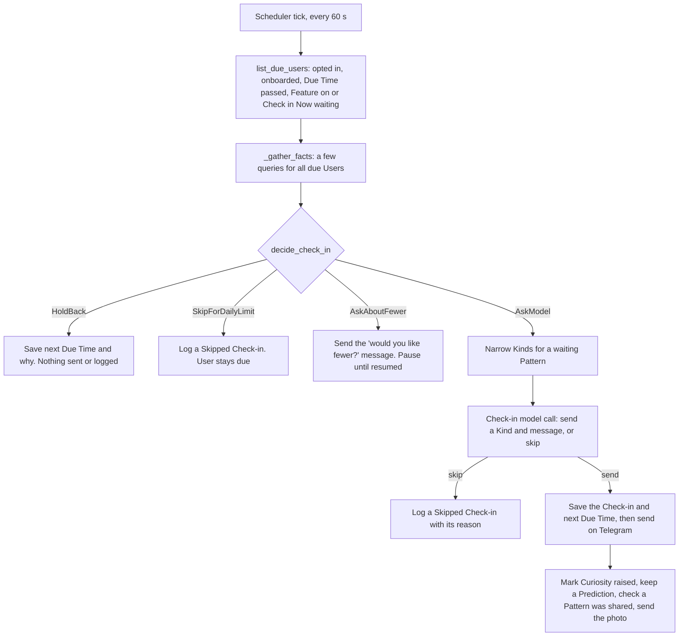

# Check-ins: how Zeph messages first

A **Check-in** is a message Zeph sends without the User writing first. It should feel like a friend saying hello, not a reminder. Terms in **bold** are defined in `CONTEXT.md`.

A User gets Check-ins only when they opted in, finished onboarding and the **Check-ins** Feature works for them.

## Check-in Kinds

A **Check-in Kind** is the style of a Check-in. Admins add, edit and remove Kinds on the Dashboard (`CheckInKindService` in `src/companion/core/check_in_kinds.py`). The list is read fresh on every tick, so a change counts straight away. A name is at most 80 characters, a description at most 500, and names must differ.

The starting Kinds are in `src/companion/seed/check_in_kinds.yaml`. They load on first run only, when there are no Kinds at all.

| Kind | Fixed behaviour |
|---|---|
| A casual hello | none |
| A follow-up | none |
| A present-moment pause | none |
| A thought to reflect on | none |
| A look back at a photo | `sends_shared_photo`: sends one of the User's Shared Photos after the message |
| Something I've been wondering | `raises_curiosity`: asks one of the User's Curiosities |
| Something I've noticed | `shares_pattern`: tells the User a ready Pattern |

Admins can't change the three flags. `has_fixed_behaviour` on `CheckInKind` (`src/companion/core/models.py`) is true for any Kind with one of them.

## How a Check-in is sent

1. **The tick.** `src/companion/main.py` runs the scheduler every 60 seconds (`SCHEDULER_INTERVAL_SECONDS`). Each tick, `ScheduledWork.tick` (`src/companion/core/scheduled_work.py`) ends quiet Conversations, runs Conversation-end steps, rewrites the Portraits a deletion asked for, then calls `CheckInService.send_due`, then deletes old data. Platform Settings are read once per tick.
2. **Who is due.** `list_due_users` (`src/companion/adapters/postgres/repositories.py`) picks Users with Check-ins on, onboarding done and `check_in_next_due_at` passed. Users with the Feature off on the Admin side are left out (but stay due), unless a Check in Now waits.
3. **Facts.** `_gather_facts` in `src/companion/core/check_ins.py` reads, for all due Users at once: Telegram Connection, latest Conversation, Daily Message Limit, recent Check-ins, Shared Photos, waiting Curiosities, Curiosity Check-ins in the last 7 days, and Patterns ready long enough.
4. **Decide.** `decide_check_in` (`src/companion/core/check_in_decision.py`) is pure code. It checks in this order and returns the first that applies:

   | Check | Result |
   |---|---|
   | Check-ins Feature doesn't work for them | hold back |
   | Paused | hold back until the pause ends |
   | In Quiet Hours (their local time) | hold back until Quiet Hours end |
   | No Telegram Connection | hold back, no Due Time, until they connect |
   | A Conversation is open | hold back as "waiting to be woven in", until the quiet gap passes |
   | Used up today's Daily Message Limit | one Skipped Check-in that day, then hold back |
   | Sent Check-ins ignored in a row ≥ Ignore Threshold | "would you like fewer?" message, then pause until resumed |
   | No Kind may be sent | hold back |
   | Otherwise | ask the Check-in model |

   Held-back Users get their next Due Time and reason saved in one statement (`_hold_back`), so Admins can see why on the Check-in Schedule.
5. **Which Kinds.** `kinds_that_may_be_sent` drops the photo Kind unless they have Shared Photos and Photo Viewing works; the Curiosity Kind unless a Curiosity is due, Curiosities work and they are under `curiosity_check_ins_per_week`; the Pattern Kind unless a Pattern waits (see below). Then `kinds_with_pattern_settled` offers **only** the Pattern Kind when a Pattern can be shared now, and drops it when not.
6. **The model call.** `CheckInService._decide` calls the model on `check_in_model`, with thinking from `check_in_thinking` (`thinking_to_use`). Instructions are the Persona (`persona`) then `check_in_prompt`. The input (`describe_check_in`) holds: the Kinds offered, what to call them, their local time, the last 5 Check-ins, memory (Portrait, Memory Items, newest Day Summaries, even while User Memory is off), and, only for the Kinds that need them, numbered Shared Photos, due Curiosities or the Pattern to tell.
7. **Reading the answer.** `read_check_in_decision` wants JSON: `{"decision": "send", "kind", "message"}` or `{"decision": "skip", "reason"}`, plus `photo` or `curiosity` numbers for those Kinds. A Kind not offered, an empty message or reason, or a bad number raises `InvalidCheckInAnswerError`. Nothing is saved then, and the User is tried again next tick.
8. **Sending.** `_save_then_send` saves first, then calls `ChatChannel.send_text` (`TelegramChatChannel` in `src/companion/adapters/telegram/chat_channel.py`). Nothing is saved or sent if the Due Time changed since the tick read it (e.g. a reply wove it in). Then:

   | Telegram result | What happens |
   |---|---|
   | Sent | counts as sent |
   | Refused (`MessageRefusedError`) | taken back, tried again 15 minutes later (`REFUSED_CHECK_IN_RETRY_GAP`) |
   | Blocked (`ChatBlockedError`) | replaced by a Skipped Check-in ("User has blocked the Companion on Telegram") |
   | Any other error, e.g. timeout | counts as sent, since it may have arrived |

9. **After sending.** A Curiosity asked is marked raised. A Pattern Check-in runs the shared check. A Shared Photo is sent after the message; if that fails, the photo is removed from the Check-in row and the message still counts.
10. **What is recorded.** One row in `check_ins`: outcome (sent, skipped, asked about fewer), when it was decided, Kind, the message, skip reason, photo, Curiosity, woven in or not, the Admin for a Check in Now, and when the User replied. Admins see it on the Check-in Log without the message text. Tokens go to Usage, and the call to the Model Call Log under `TraceKind.CHECK_IN`.
11. **The reply.** The User's first message within `check_in_reply_window_hours` claims the Check-in as replied, and the new Conversation starts with it (`src/companion/core/conversations.py`).

### Due Times

`next_due_after_decision` sets the next Due Time: the first "previous Due Time + n × gap" still to come, so missed ones aren't made up. It is never within half a gap of the last sent Check-in. The gap comes from `check_in_hours_between` for the User's Check-in Frequency. Turning Check-ins on or changing the frequency starts a new rhythm one gap from now (`next_due_after_change`). Changing Quiet Hours or time zone while held back by Quiet Hours makes them due now (`next_due_after_quiet_hours_move`).

A new User's settings start as a few times a week, Quiet Hours 22:00 to 07:30 (`CheckInSettings` in `models.py`). Quiet Hours may run past midnight; equal start and end means none. A User with no time zone is treated as UTC (`local_now` in `src/companion/core/timing.py`).

### Check in Now

An Admin asks on the Check-in Schedule (`CheckInScheduleService.check_in_now` in `src/companion/core/check_in_schedule.py`). It is refused for a User not opted in or onboarded, or with no Telegram Connection. `decide_check_in_now` skips the Feature switch, pause, Quiet Hours, half-gap, Daily Message Limit and Ignore Threshold. Only no Telegram Connection, an open Conversation or no Kind holds it back. The next Due Time is one gap from now.

## Woven-in Check-ins

A Check-in that comes due while a Conversation is open is not sent on its own. Instead a reply may weave it in, like a friend drifting onto a side topic. Code: `src/companion/core/woven_check_ins.py`, called from `src/companion/core/reply_service.py`.

1. `may_weave_check_in` (code): opted in, onboarded, the Understanding doesn't find them struggling, and either a Check in Now waits or they are due with the Feature on and not paused. Quiet Hours don't matter here.
2. `kinds_to_weave_in` offers only Kinds without fixed behaviour.
3. The Reply Plan weighs it with everything else and answers a Kind and a note, or none (`woven_check_in_from_plan` in `src/companion/core/reply_plan.py`).
4. `WovenCheckIns.save` saves it and moves the Due Time on, before the reply is written.
5. The Reply gets it as an optional extra, last in its priority order (`format_woven_check_in_for_reply`).
6. `was_brought_up`: a yes/no call on `check_in_model` without thinking (unless that model always thinks), with `BROUGHT_UP_CHECK_PROMPT`. Left out, unclear or a failed reply means `take_back`, so it stays due.

How it differs: no message of its own, no Check-in prompt, never while struggling, ignores Quiet Hours, never counts toward the Ignore Threshold (`ignored_in_a_row` passes over it), and is logged with `woven_in` set. If no reply weaves it in, it goes out on its own once the Conversation could end.

## Curiosities, Patterns and Predictions

- **Curiosity Check-in.** The "Something I've been wondering" Kind asks one Curiosity from `due_curiosities` (`src/companion/core/curiosities.py`). Once sent, it is marked raised. The reply-side pace rules in `curiosity_pace.py` are not used here; the weekly cap `curiosity_check_ins_per_week` is.
- **Prediction follow-ups.** A Prediction follow-up is a Curiosity, so it can go out this way while Pattern sharing works. If the Curiosity was there to give a shared Pattern a new Prediction, `PredictionKeeper.record_given` (`src/companion/core/predictions.py`) checks with a small call whether the message gave one, and keeps it.
- **Pattern shared as a Check-in.** `PatternSharing.pattern_to_offer_in_check_in` (`src/companion/core/pattern_sharing.py`) offers the Pattern ready longest, once it has waited `pattern_share_wait_days` for a moment in chat. Not while Pattern sharing is off, their last Message was read as struggling, or `patterns_shared_per_week` is reached. Ready Patterns are checked again first. After sending, `record_if_shared` runs `SHARED_CHECK_PROMPT` on `check_in_model`; only `"shared": true` in its JSON answer moves the Pattern to shared (`ShareVia.CHECK_IN`).

## What stops a Check-in

| Stop | Where |
|---|---|
| User hasn't opted in or finished onboarding | `list_due_users` |
| Check-ins Feature off for everyone or for the User | `list_due_users`, `decide_check_in` |
| Paused (a day, a week, until resumed) | `decide_check_in` |
| Quiet Hours | `decide_check_in` |
| No Telegram Connection | `decide_check_in` |
| Conversation open (woven in instead) | `decide_check_in` |
| Daily Message Limit used up | `decide_check_in` |
| Ignore Threshold reached | `decide_check_in` |
| No Kind may be sent | `kinds_that_may_be_sent` |
| The model chose to skip | `read_check_in_decision` |
| User blocked the bot | `_save_then_send` |
| Struggling (woven-in and Pattern Check-ins only) | `may_weave_check_in`, `pattern_to_offer_in_check_in` |

## Settings

Platform Settings, with seed values from `src/companion/seed/platform_settings.yaml`. Keys are in `src/companion/core/platform_settings.py`.

| Setting | Seed value | Meaning |
|---|---|---|
| `check_in_prompt` | (text) | Tells the model to send a Kind and message, or skip, as JSON |
| `check_in_model` | `deepseek/deepseek-v4.1-flash-1017` | Model for Check-ins and the small yes/no checks |
| `check_in_thinking` | `true` | Whether the Check-in call thinks first |
| `check_in_hours_between` | weekly 168, few_times_a_week 56, most_days 24, a_few_times_a_day 6 | Gap per Check-in Frequency, in hours (1 to 720) |
| `check_in_ignore_threshold` | `3` | Ignored Check-ins in a row before "would you like fewer?" (1 to 10) |
| `check_in_fewer_message` | (text) | The "would you like fewer?" message |
| `check_in_reply_window_hours` | `24` | How long a message still counts as the reply. Not on the Admin settings page |
| `curiosity_check_ins_per_week` | `1` | Most Curiosity Check-ins in any 7 days (0 to 7) |
| `pattern_share_wait_days` | `5` | Days a ready Pattern waits for a moment in chat before a Check-in may share it (0 to 90) |
| `patterns_shared_per_week` | `1` | Most new Patterns told in any 7 days, in chat or Check-in (0 to 7) |
| `conversation_quiet_gap_minutes` | `15` | Decides whether a Conversation is still open |
| `recent_conversation_summaries` | `3` | Day Summaries given to the Check-in model (and to each reply). Not on the Admin settings page |

## Where to look

| Concern | File |
|---|---|
| Tick and order of work | `src/companion/core/scheduled_work.py` |
| Rules: hold back, Kinds, Due Times | `src/companion/core/check_in_decision.py` |
| Facts, model call, sending, User settings, log | `src/companion/core/check_ins.py` |
| Woven-in Check-ins | `src/companion/core/woven_check_ins.py` |
| Admin Schedule, Admin Setting Changes, Check in Now | `src/companion/core/check_in_schedule.py` |
| Kinds | `src/companion/core/check_in_kinds.py`, `src/companion/seed/check_in_kinds.yaml` |
| Admin API | `src/companion/adapters/http/admin_api.py` (`/api/admin/check-in-kinds`, `/check-ins`, `/check-in-schedule`) |
| User API | `src/companion/adapters/http/dashboard_api.py` (`/api/check-ins`, `/api/check-ins/pause`) |
| Due Users query, `check_ins` and `check_in_kinds` tables | `src/companion/adapters/postgres/repositories.py`, `tables.py` |
| Dashboard pages | `web/src/app/(dashboard)/admin/check-in-kinds`, `check-in-log`, `check-in-schedule`; `web/src/app/(dashboard)/(user)/check-ins` |

## Tests

- Rules: `tests/test_check_in_decision.py`, `test_check_in_hold_back.py`, `test_check_in_rhythm.py`, `test_check_ins_over_daily_limit.py`.
- Sending: `tests/test_check_ins.py`, `test_check_in_sending.py`, `test_check_in_send_failures.py`, `test_check_in_now.py`.
- Admin: `tests/test_admin_check_ins.py`, `test_check_in_schedule.py`, `test_check_in_kinds_seed.py`.
- Woven-in: `tests/test_woven_in_check_ins.py`.
- Photo Kind: `tests/test_look_back_check_in.py`.
- Curiosities and Patterns: `tests/test_curiosity_check_in.py`, `test_prediction_follow_up.py`, `test_pattern_sharing.py`.
- Dashboard: `web/src/components/CheckInKindsManager.test.tsx`, `CheckInSchedule.test.tsx`, `CheckInLog.test.tsx`, `CheckInsSettings.test.tsx`.
- Eval: the Understanding Eval checks whether the Reply Plan weaves in a due Check-in (`check_woven_in` in `src/companion/core/evals/understanding_checks.py`; the case field is "Weaves in the Check-in" in `case_shapes.py`). There is no Eval for Check-ins sent on their own. Evals cost money.
