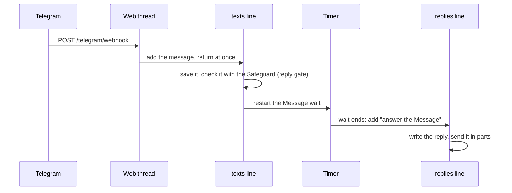

# How work runs: processes, queues, locks and scheduled work

What runs where, in what order, and what holds it together. Read this before you change anything that runs in the background, waits, or takes a lock. For the steps of a reply and of a Conversation end, see `docs/message-pipeline/README.md`. This file only covers timing and running at the same time.

## Processes and containers

All from `docker-compose.yml`. `COMPOSE_PROFILES` in `.env` picks the extra ones.

| Container | Profile | What runs |
|---|---|---|
| `postgres` | always | Postgres 16 with pgvector |
| `backend` | always | `python -m companion.prestart`, then **one** `uvicorn` process (`companion.main:build_production_app`, no `--workers`) on port 8000 |
| `web` | always | The Next.js Dashboard on port 3000 |
| `eval-runner` | `eval` | `python -m companion.eval_runner` |
| `ngrok` | `local` | Tunnel from Telegram to `backend:8000` |
| `caddy` | `prod` | HTTPS. `/api/*`, `/telegram/*` and `/health` go to the backend, the rest to the Dashboard (`Caddyfile`) |

**Before the backend serves** (`prestart.py`, `prepare`): it migrates the database, loads seed data (Platform Settings, Copy, the Pattern Catalog, Eval Cases, Knowledge and more) and registers the Telegram webhook, unless `TELEGRAM_WEBHOOK_REGISTER` is off. Only one stack can own the webhook, so worktrees turn it off.

**Inside the backend process** (`app.py`, `create_app`) there are four kinds of threads:

| Threads | Built in | Runs |
|---|---|---|
| Web pool | FastAPI | Webhooks and Dashboard requests |
| User work pool, `MESSAGE_POOL_SIZE` threads (default 50) | `ThreadPoolUserWorkQueue` | Each User's texts and replies |
| One `scheduler` thread | `InProcessScheduler` | The tick, every 60 seconds |
| One thread per waiting timer | `ThreadTimer` | Message waits, typing, the end of sticker adding mode |

**The Eval runner** works Queued Eval Runs one at a time, against its own Eval database (ADR 0013). It holds a Postgres advisory lock (`hold_runner_lock`), so a second runner just waits. With nothing to do it checks again every 2 seconds. It never runs the scheduler.

## One backend process, in-memory queues (ADR 0032)

The ADR is `docs/adr/0032-one-backend-process-with-in-memory-per-user-queues.md`. The backend is one process. Nearly all its work waits on the model or Telegram, so one process with enough threads goes a long way. The ADR sizes it for about 500 signed-up Users, 25–50 chatting at once.

**The queue** (`src/companion/adapters/user_work_queue.py`) holds lines of work by key, in memory:

| Key | Holds | Built in |
|---|---|---|
| `texts:<Telegram sender ID>` | Each message the sender sends: `/start`, the "sign up first" reply, or saving and checking a text | `IncomingMessageHandler.handle` |
| `replies:<User ID>` | Answering the User's Message | `IncomingMessageHandler._queue_answer` |

- Each line runs **one piece at a time, in order**. So a User holds at most two threads: one checks texts, one writes the reply.
- After each piece the line goes to the back of the pool, so a heavy texter can't hold a thread from others.
- A line with nothing waiting holds no thread.
- A failed piece is logged and the line goes on.

**On restart or deploy, waiting work is lost.** Texts not yet handled, Message waits and replies not yet sent are gone, and the User gets no reply to them. Texts already saved stay saved. Work kept in Postgres (ended Conversations, due Check-ins) is picked up again by the next tick.

## A Message's timing

1. **Webhook in** (`adapters/telegram/webhook.py`). It checks the secret header, reads the update and calls `IncomingMessageHandler.handle`. That only looks up the sender's Telegram Connection and adds work to the `texts:` line. No web thread waits for a reply.
2. **Checked as it arrives.** On the `texts:` line each text is saved and checked by the Safeguard through `ReplyGate.screen`. A crisis is never held back by the wait.
3. **The Message wait** (`core/message_wait.py`). After each text the timer `message:<User ID>` starts again. Its length follows how the latest text reads:

   | Latest text reads | Setting | Default |
   |---|---|---|
   | Finished (a question, or 15+ words ending in `.`, `!` or an emoji) | `message_wait_finished_seconds` | 2 s |
   | Trailing (ends in `...` or `,`, ends with a word like "and", or a photo with no caption) | `message_wait_trailing_seconds` | 12 s |
   | Neither (a sticker too) | `message_wait_seconds` | 6 s |
   | Never past this from the first text | `message_wait_cap_seconds` | 20 s |

4. **The answer waits for texts still in line.** A message counts as not yet handled from when it arrives. If the wait ends while one is still on the `texts:` line, the answer is held back until it is handled.
5. **A new text drops a reply not yet sent.** While a reply is being written, a new text drops it (`ReplyAttempt`) and the Message is answered again with every text. Once any part is sent, a new text starts the next Message.
6. **The reply** is on the `replies:` line. For its steps see `docs/message-pipeline/README.md`.

The Message waiting to be answered and the reply being written live in `IncomingMessageHandler` and are only changed under one `threading.Lock` (`_pending_messages_guard`), because the two lines run at the same time.

**Typing** (`core/typing_keeper.py`). From the first text until something is sent, `TypingKeeper.keep_up` shows typing again every `typing_repeat_seconds` (4), with the timer `typing:<chat ID>`. Sending a text, sticker or photo stops it. Before each part of a reply, typing is shown and the thread sleeps for `typing_seconds_per_character` (0.05) per character, kept between `min_typing_seconds` (1.5) and `max_typing_seconds` (5) (`typing_pause_seconds` in `core/conversations.py`). That sleep holds the `replies:` thread.

## How a Conversation ends

- A Conversation ends after `conversation_quiet_gap_minutes` (default 15, Admins can set 5 to 1440) with no message from either side.
- Nothing ends it at the moment the gap passes. A new message after the gap starts a new Conversation (`is_open` in `core/timing.py`), and the next tick marks the old one ended.
- Each tick calls `end_quiet` (sets `ended_at` on quiet Conversations), then `list_ended_unprocessed`, oldest first, and runs `PostConversationProcessor.process` on each. **This all runs on the scheduler thread**, one Conversation after another.

## Scheduled work

`ScheduledWork.tick` (`core/scheduled_work.py`). `InProcessScheduler` (`adapters/scheduler.py`) waits 60 seconds (`SCHEDULER_INTERVAL_SECONDS` in `main.py`, not a setting), runs the tick, then waits again. Ticks never overlap: a long tick pushes the next one back. Platform Settings are read once at the start of a tick.

Each tick runs these, in order:

| Job | Code | What it does |
|---|---|---|
| End quiet Conversations | `conversations.end_quiet` | Ends each open Conversation quiet for the quiet gap |
| Conversation-end steps | `PostConversationProcessor.process` | For each ended, unprocessed Conversation |
| Portrait rewrites | `PortraitWriter.rewrite_requested` | Rewrites the User Portraits a deletion asked for, or clears them |
| Check-ins | `CheckInService.send_due` | Decides a Check-in for every User due one now |
| Message Retention | `MessageRetention.delete_expired` | Deletes messages and Model Call Log entries older than `message_retention_days` (30) |
| Auth accounts | `UserDataService.delete_pending_auth_accounts` | Tries again to delete auth accounts still on the pending list |

The tick runs its jobs one after another on the scheduler thread. ADR 0032 once planned a small pool to run them in parallel; it was never built.

`ThreadTimer` (`adapters/timer.py`) is the other source of timed work. Starting a key again restarts its wait, and only the newest wait runs. Keys: `message:<User ID>`, `typing:<chat ID>`, `sticker-adding:<User ID>` (ends sticker adding mode after `sticker_adding_quiet_gap_minutes`, 5).

## Locks and transactions

**Transactions across repositories** (ADR 0008). `with repositories.transaction() as transaction:` gives one Postgres transaction. Use `transaction.repositories` inside it. It is saved when the block ends and undone if it raises.

**`Transaction.lock_user(user_id)`** runs `SELECT ... FOR UPDATE` on that User's row in `users`, until the transaction ends. Another transaction locking the same User waits, then sees the changes. It is needed because a User's tick work, their reply and their Dashboard requests run on different threads at the same time.

| Who takes it | Where | Why |
|---|---|---|
| Scoring Patterns | `PatternScorer.score` | An Observation deleted meanwhile is never counted |
| Deleting a kept quote, a Pattern, a Life Thread | `user_memory.py` (`delete_kept_quote`, `delete_pattern`, `delete_thread`) | Waits for scoring under way; then scores again |
| Ready gate | `ReadyKeeper._look`, `ReadyKeeper.settle` | Judged from what is stored now |
| Sharing a Pattern, push-back | `PatternSharing._record_shared`, `settle_reactions` | A Pattern shared by another message, or no longer ready, is left alone |
| Predictions | `PredictionKeeper.settle_shared`, `keep_follow_ups`, `_check_and_record` | Two Conversation ends, or a reply, never write the same one |
| The Agenda | `AgendaKeeper.keep` | An Observation deleted meanwhile is never aimed at |
| Starter Thought Experiments | `StarterThoughtExperimentKeeper.keep` | Two Conversation ends never write the same one |

`lock_admins` locks the Admin rows in ID order, for "there is always one Admin".

**Rules**

- Take `lock_user` when you read a User's Observations or Patterns and save something that depends on them, or delete their evidence.
- **Never call a model while you hold it.** Ask first, then lock, read again and judge again. `ReadyGate.check` does this: `look` under the lock, the "other side" model call outside it, then `settle` under the lock, which counts the last checks as not made if the Observations changed. `_check_and_record` asks the model, then locks.
- Lock one User per transaction. Keep it short.

## Failure handling

- **Conversation-end steps.** Every step except the Day Summary is wrapped in `try`/`except` in `post_conversation.py`: a failure is logged ("Could not tag Observations", ...) and the next step still runs. It is **not** tried again, so nothing is added twice.
- **The Day Summary.** An unreadable answer is asked again once; then the Conversation is marked processed with nothing saved. If the model call raises, `process` raises, the Conversation stays unprocessed and the next tick tries it again.
- **The tick.** A failed Conversation is logged and the others still go ahead. A failed tick is logged and the next one still runs.
- **Check-ins and auth accounts.** One that fails is tried again next tick.
- **Replies.** A failed reply sends `REPLY_FAILED_MESSAGE`, unless a new text dropped it. A failed text check sends it too and drops the rest of the Message.

## Load test

`make load-test` (in a worktree only) starts the stack with `docker-compose.load-test.yml` on top: a fake model that waits 3–8 s, a chat channel that logs, no web search and a scheduler that logs each tick's length. Postgres and the embedder are real, so it is free. `scripts/load_test` posts Telegram updates as many Users chatting at once, times a Dashboard page and one tick with many due Check-ins and ended Conversations, and prints a report against the bar in `.scratch/scaling/PRD.md`. Afterwards run `make restart` to put the backend back.

## Single-process assumptions today

With two backend processes, these break:

- **The queue.** Lines are per process, so one User's texts could be handled out of order or at the same time.
- **The Message.** The waiting Message, "not yet handled" counts and the reply being written live in one process's memory. Texts sent to two processes would make two Messages and two replies.
- **Timers.** Message waits, typing and sticker adding mode are in-memory threads. A text on the other process can't restart or stop them.
- **The scheduler.** Each process would run its own tick. Nothing claims an ended Conversation before processing it, so two ticks could run the Conversation-end steps twice.
- **Scale inside one process.** This one is a limit even with one process: each waiting timer is its own sleeping thread, and typing pauses hold a `replies:` thread.

The ADR's way out is a queue in the database behind the same `UserWorkQueue` port (`.scratch/scaling/`).
