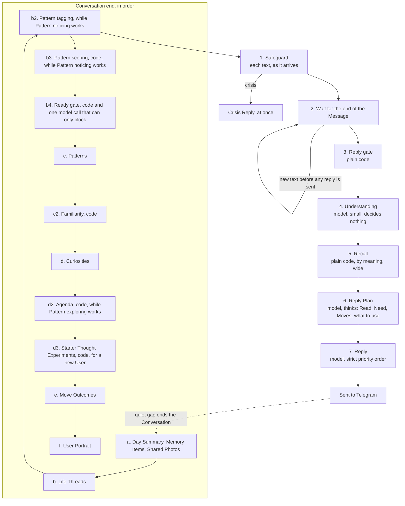

# How Zeph handles a message

Read this before planning or changing anything in the reply path, the Conversation-end steps or User Memory. Terms in **bold** are defined in `CONTEXT.md`; this file says how they fit together.

**Status:** target design, agreed on 19 Nov 2026 in a review of a real Conversation where Zeph brushed a User off mid-rant and only gave a useful Read after being pushed three times. It is **not built yet**, except where a "Built" note says a part now matches. "Today" notes say where the code still differs. Open points are listed at the end.

## What a reply is for

In every reply that matters, Zeph understands the User, forms an honest **Read** of what is really going on, **from the Outlook Admins wrote, never from views of its own**, and helps them move: with a view, a question that challenges, or a step. How the User is feeling decides when and how gently Zeph says it, not whether it has a view. Listening is how it gets there, not the goal.

The heart of it is **Patterns**: noticing what keeps showing up across a User's life and telling them at the right moment, so they see something about themselves they hadn't put into words. That is where they start questioning, and where Zeph is most useful.

## Decisions at a glance

Agreed in the 19 Nov 2026 review. Each is explained in the step below it applies to.

1. **Zeph always forms a Read** of what is really going on, from the **Outlook** Admins write (one piece of prose in the Persona, apart from its voice), never from views of its own.
2. **It says the Read** only when there's room, it's worth saying and it isn't a repeat; when the User asks for its view, it gives its deepest Read at once.
3. **Patterns** are their own kind of User Memory: what keeps showing up across a User's Threads, including what they keep choosing (their values). A Pattern is of a Pattern Type from the Pattern Catalog, tested by code from Observations, or unmatched: noticed across Threads but fitting no Pattern Type, hidden, never offered, though the Read may think with it (ADR-0024, which replaces ADR-0020; `docs/pattern-pipeline/README.md`).
4. **One home per thing learned:** fact → Memory Item, story → Life Thread, recurring across stories → Pattern. The Portrait uses confirmed Patterns only.
5. **Nothing old is forgotten:** Threads are found by meaning however old; Patterns re-read the days behind their evidence (messages within retention, Day Summaries after); Summaries are thorough enough to stand in for deleted messages.
6. **A Message is everything before the pause:** a longer wait, and Zeph starts over if a text lands before any of the reply has gone out.
7. **Small one-job steps** (ADR-0021): Understanding (reads, decides nothing) → Recall (code, wide) → Reply Plan (Read, Need, Moves, what to use, whether a Check-in fits) → Reply. No fast path.
8. **Recall is wide, the reply is focused:** anything that comes to mind stays in mind for the Conversation; the Reply Plan picks what the reply uses. Patterns also come to mind directly in new situations.
9. **Said / read / unclear:** the Understanding keeps the User's words apart from Zeph's guesses.
10. **Check-ins are an option, never an order:** weighed in the Reply Plan; the separate Woven-in Check-in model goes.
11. **The Reply has a strict priority order,** with optional extras last.
12. **Every Admin-editable field explains itself** with a short hint.
13. **One Day Summary per User per day** (their time zone), rewritten from all of that day's messages each time a Conversation ends; replaces per-Conversation Summaries. A Conversation past midnight belongs to the day it started.
14. **Learning happens when a Conversation ends,** not after each reply.
15. **Knowing where the Conversation is going:** each Reply Plan says in a line where the Conversation is now and sees the earlier ones, so Zeph holds or pushes across the Conversation instead of flipping Need every message.
16. **Commitments are followed up:** one the User agreed to goes into its Life Thread with its date (seen by the User), plus a hidden Curiosity to ask how it went once the day has passed. Goals the User shows plainly are kept in Goals; ones Zeph only infers are Patterns.
17. **A friend who doesn't forget:** every reply sees the **Recent Messages**: all messages from the last 24 hours across Conversations, word for word; the Reply Plan has a tool to read a past day's messages within retention; after that, the Day Summary, Threads and Patterns remain. The Conversation and its quiet gap still bound Check-ins, limits and learning.
18. **Day Summaries carry feeling as well as facts:** what happened, how it felt and why, what it meant to them, how their mood moved, so a look back months later still makes sense. A **Day Summary Eval** checks it: the Judge answers questions about facts, feelings and what Zeph offered from the Summary alone (Evals cost money; run only on demand).
19. **The wait follows how the last text reads** (agreed 23 Nov 2026; built 23 Nov 2026, the cap too): short when it reads finished, long when it trails off, medium otherwise, never past a cap from the first text. Start-over catches a wrong guess. A per-User typing rhythm was considered and left out until real chats show slow typists being cut off.
20. **Replied-to Texts are read** (agreed 23 Nov 2026, built 23 Nov 2026): who sent it, when, and what it said (or the highlighted part), from the chat update itself. The Safeguard, Understanding, Recall, Reply Plan and Reply all see it. *Built for the Understanding, Reply Plan and Reply (23 Nov 2026): the Telegram adapter reads `reply_to_message` and `quote` into `IncomingMessage.replied_to` (sender by `is_bot`, so a reply to a Check-in is a reply to the Companion's text; highlighted part or text, caption or sticker emoji, cut to 500 characters). Each saved User text keeps it in `conversation_messages.replied_to` (migration 0074), so later replies and the Recent Messages see it; it goes with the row on Delete My Data and Message Retention. `readable_content` in `core/transcripts.py` writes it before the text, e.g. `Person: (replying to the Companion's text from 3 Nov 2026, "have you told your mum?") not yet`, and the Reply's own history says "your text". Conversation-end steps see it too, through `to_transcript_lines`, with the day in the User's time zone (24 Nov 2026: the transcript helpers take `time_zone` with no default, so a caller can't forget it; UTC only for a User with none).* *Built for the Safeguard and Recall (23 Nov 2026): the Safeguard reads each text with its note as it arrives, through `to_chat_history`, in the same call, so a "yes" replying to Zeph's self-harm question is read with that question. `recent_texts_to_search` in `core/life_threads.py` puts each recent text's Replied-to Text before it, so the searches for Life Threads, Patterns and Move Outcomes use it, and a reply to a weeks-old text brings back the Thread it was about.* *Built (23 Nov 2026): a reply to a sticker gives Zeph only its emoji, and a reply to a photo that can't be looked at (see below) only its caption, so `response_prompt` tells the Reply not to describe what's in a photo or sticker it can't see, and to go by the caption and what the User says, or ask. Migration 0078 reloads `response_prompt` from the seed. Before, a reply "so cute" to a photo captioned "my cat" got a made-up detail about the cat's ear tuft.* *Built for replied-to photos (23 Nov 2026): the Telegram adapter also reads the replied-to photo (its largest size, or an image sent as a file, as `parse_photo` does) into `RepliedToText.photo`, never saved. When the text arrives, before the Safeguard, `PhotoService.read_replied_to` looks at it with the same step as a new photo (`describe`: `photo_model`, `photo_description_prompt`, `photo_retry_count`), and the note ends with it, e.g. `(replying to their own photo from 3 Nov 2026, "my cat", [photo: a grey cat asleep on a laptop]) so cute`. It is kept as `photo_note` in the saved `replied_to` (no migration: the column is JSON), so later replies see it, and it goes with the row on Delete My Data and Message Retention. The Safeguard always reads the description; with Photo Viewing off the Understanding, Reply Plan and Reply get only the caption and the "Photo Viewing off" note, and no description is kept. A photo that can't be downloaded or looked at leaves the caption only. Limits: one photo-model call per reply to a photo, counted in the User's usage and shown in the Model Call Log, with no reuse when the same photo is replied to twice (so with Photo Viewing off the call still happens, for the Safeguard); the reply waits a few seconds more, as for a new photo; Telegram may not keep an old photo downloadable, and an image file over 20 MB can't be downloaded, so those get the caption only; a reply points at one photo, so an Album's other photos aren't looked at; stickers stay as their emoji, and videos, GIFs and files aren't looked at; a photo whose saved message Message Retention already deleted is still looked at, since it comes from Telegram and the User pointed at it.*
21. **Zeph replies to a specific text** (agreed 23 Nov 2026, built 23 Nov 2026) only when a Message has several threads and a reply text answers one that isn't the latest, at most once or twice per reply. *Built (23 Nov 2026): each saved User text keeps its chat channel message ID in `conversation_messages.chat_message_id` (migration 0077, which also reloads `response_prompt` from the seed). The Reply sees a Message of more than one text numbered (`[1] work was rough`, `[2] also mum called`), and the prompt says a text may start with `[re 2]`. `link_to_texts` in `core/response_composition.py` strips the marker and sends that text as a reply to the Message's 2nd text; a marker naming the latest text, no text of this Message, or past two per reply is dropped and the text sent normally. `ChatChannel.send_text` takes an optional ID to reply to, which the Telegram adapter sends as `reply_parameters` with `allow_sending_without_reply`, so a deleted original never stops the text. An Album points at its first item.*

## The flow

Rule of thumb: each model call does **one job**. Rules that aren't judgment calls are plain code. Nothing optional reaches the reply as an order; it is weighed in the Reply Plan.

## Each step: what, why, how

### 1. Safeguard

- **What:** checks every text for crisis (suicide or self-harm, danger to others, abuse, medical emergency).
- **Why:** safety comes before everything, and a crisis must never wait for the rest of the Message.
- **How:** one model call per text as it arrives, read in the light of the Conversation. A crisis gets the Crisis Reply at once and a Safeguard Event; the rest of that Message isn't answered normally. When unsure, it treats the text as a crisis.

### 2. Wait for the end of the Message

- **What:** collects everything the User sends before pausing into one **Message**.
- **Why:** people say one thing across several texts ("haha / i get it / you know.. / … / what do you think?"). Answering each piece separately cuts them off and answers half a thought.
- **How:** waits after the last text for as long as it takes to type the next thought (Admin-set). If a text arrives while the reply is being written and before any of it has gone out, Zeph drops what it was writing and starts again with everything; a Woven-in Check-in already saved is taken back. Once part of a reply has gone out, a new text starts the next Message.
- *Built (20 Nov 2026): the wait was 15 seconds by default (`message_wait_seconds`; migration 0066 moved it from the old 4 only where an Admin hadn't changed it; since 23 Nov 2026 it follows the last text, below). A text checks in at once, even while a reply is being written. Until the first part of a reply is sent (after its typing pause), a new text drops it: nothing is sent, a saved Woven-in Check-in is taken back, and the Message is answered again with every text once the User pauses. The Message counts once toward the Daily Message Limit however many times it starts over. This works inside the in-memory per-User queue (ADR-0018; built 23 Nov 2026: a User's messages are handled one at a time on one line of the queue and their replies on another, so a text is checked while a reply is written, and a reply waits for texts still in line). Before: a text sent mid-write waited behind the reply and started a new Message, so a 10-text rant got 5 replies, each landing mid-rant.*

- *Built (23 Nov 2026): the wait depends on the last text, decided by one pure function, `message_wait` in `core/message_wait.py`. **Finished** (ends with `?`, or at least `message_wait_long_text_words` (15) words ending in `.`, `!` or an emoji): `message_wait_finished_seconds` (2). **Trails off** (ends with `...`, `…` or `,`; its last word is in `message_wait_trailing_words`, e.g. `and`, `so`, `but`; the whole text is one of the short openers in that list, e.g. `wait`, `ok so`, `lol`, `hmm`; a photo with no caption): `message_wait_trailing_seconds` (12). **Neither** (including a sticker alone): `message_wait_seconds` (6; migration 0075 moved it from 15 only where an Admin hadn't changed it). Matching ignores case and trailing spaces. An Album's wait restarts as each item arrives and judges the Album so far as one text by its caption. All five are field rows with hints in the Conversations section of Platform settings (the words list is a comma-separated editor), whole seconds 0–60, words 1–100, list not empty. The **cap**: no Message waits more than `message_wait_cap_seconds` (20) from its first text. Each wait is the rule's seconds or the time left to the cap, whichever is shorter, never below zero. The handler keeps when the Message's first text arrived; start-over keeps it, so a Message that starts over still counts from its first text, and a new Message after a reply has gone out starts its own cap. The cap is a field row with a hint next to the waits (0–60); saving a cap shorter than any of the three waits, or a wait longer than the cap, is refused. Migration 0076 adds it at 20, or at the longest wait already stored if an Admin set one longer, so no Admin's wait is cut short.*

### 3. Reply gate

- **What:** applies rules that are not judgment calls: the Daily Message Limit, Delete My Data confirmation, and similar.
- **Why:** account rules must be exact and the same every time; a model shouldn't decide them.
- **How:** plain code. It may stop the reply (e.g. the Limit Reply) or add a note for it (e.g. a data deletion step).

### 4. Understanding

- **What:** what the User said and means, how they feel and how strongly, what they want, whether they're struggling, whether they asked for a photo, and what past to look up. **It decides nothing about the reply.**
- **Why:** reading someone and deciding what to do about them are different jobs. Done in one call, they compete: the old combined call once wrote "don't reflect it back again" and picked Mirror in the same answer. Kept apart, the reading stays honest.
- **How:** one small model call, run on every Message however short, since "yep" is often the one that matters (no fast path). It sees the whole Message, every message from the last 24 hours across Conversations, earlier Understandings, and the User Portrait. For feelings and wants it keeps apart **said** (their words), **read** (a guess from how they said it) and **unclear**, so nothing guessed is treated as known.
- *Built (20 Nov 2026): the Understanding reads only (`core/understanding.py`, `understanding_prompt`). It is given the time, the User Portrait, earlier Understandings and the Conversation, and nothing to pick. It answers what they said and mean, feelings and wants each as said / read / unclear, mood and intensity, cause known, struggling, asked for a photo and look-up phrases. A failed or unreadable call falls back to an unclear, low mood whose cause is known. Migration 0067 reset `understanding_prompt` to the new seed, since the old one asked it to pick Needs and Moves.*

- *Built (20 Nov 2026): the **Recent Messages** (`core/recent_messages.py`), read once per reply in one query and given to the Understanding, the Reply Plan and the Reply: every message from the last `recent_messages_hours` (24) across Conversations. The Understanding and Reply Plan read them as a transcript with a "--- New Conversation, 20 Nov 2026 14:02 ---" line where a later Conversation starts; the Reply gets them as chat turns. Past `recent_messages_cap` (400) the oldest are left out and their days' Day Summaries stand in (in the Reply, with what it remembers). Earlier Understandings and Reply Plans still come from the current Conversation only. Both limits are field rows with hints in the Conversations section of Platform settings. In a live run (20 Nov 2026) a text from 23 hours earlier, on the previous day, reached all three steps and one from 25 hours earlier didn't; after a 20-minute gap the new Conversation's first reply picked up exactly where the last one stopped.*

### 5. Recall

- **What:** brings to mind everything that might matter: Life Threads, Patterns, Memory Items, Knowledge passages, older Day Summaries, Move Outcomes, due Curiosities.
- **Why:** a Read needs the dots in one place before it can join them. The useful Read in the review joined three Threads (mum's visit, the job, the project) that were never in mind together.
- **How:** plain code, searching by meaning on what the Understanding says the User means, not only their raw words. Wide on purpose: whatever passes the closeness bar comes in, capped high only to protect cost. Patterns come in through their linked Threads and directly by closeness, so one can surface in a brand-new situation. Anything that came to mind earlier in the Conversation stays in mind until it ends.
- *Built for Life Threads (20 Nov 2026): `ThreadReminder` in `core/life_threads.py` searches on what the Understanding says the User means (`means`) plus their latest texts (`life_threads_texts_to_search`, 8), by meaning and by a person or thing named in the texts. Every Thread past the closeness bar comes in, open ones first. Each one found is kept in `life_threads_in_mind` (migration 0072) and comes back for every later message of the Conversation, after the ones this message found, so a Thread reminded by message 2 still reaches the Reply Plan at message 20. At most `life_threads_per_reply` (10, allowed up to 30) are in mind at once; past it, the earlier Threads that came to mind last are left out for that message. Hold-backs (raised once per Conversation, brushed-off wait, asked to drop) apply to all of them. The Reply gets only the Threads the Reply Plan picked (touched or brought up); a failed Reply Plan gives it none. Not yet: Move Outcomes still search the latest 3 texts.*
- *Built for Patterns (20 Nov 2026): `PatternReminder` in `core/patterns.py`, after the Threads. A Pattern comes to mind when one of its linked Threads is in mind, and directly when it is at least as close in meaning as the Pattern closeness bar (`pattern_closeness_percent`, 52; its own bar since 20 Nov 2026, as Patterns are worded in general terms and score lower than Threads) to the same search (what the Understanding says the User means plus their latest `life_threads_texts_to_search` texts), so one can surface with no Thread at all. Close ones come first, then linked ones, then those from earlier in the Conversation, at most 10 (`MOST_PATTERNS_IN_MIND`, in code). Each one found is kept in `patterns_in_mind` (migration 0073) for the rest of the Conversation. A User with no unmatched Pattern costs no search. Changed (25 Nov 2026, pattern-pipeline issue 24): only unmatched Patterns come to mind now; the closed state and the wait after a push-back (`pattern_pushed_back_wait_days`) went with the Patterns kept before the catalog.*

### 6. Reply Plan

- **What:** decides what the reply does. First Zeph's **Read** of what is really going on, then the **Need**, the lead, supporting and next **Moves**, and what the reply uses from everything recalled (which Thread to bring up or leave alone, a Pattern, a Curiosity, Knowledge, a Shared Photo) and whether a due **Woven-in Check-in** fits at all.
- **Why:** this is where Zeph stops only mirroring and has something to offer. Every optional extra is weighed here against what the User needs right now, so nothing can hijack the reply. In the review, a separate Check-in model had the reply weave in a "present-moment pause" just as the rant ended, which the User took as being brushed off.
- **How:** one model call that thinks first. It is given the Persona's **Outlook** (how Zeph sees people and what helps them grow, written by Admins, so the same situation is read the same way every time), the Understanding, everything recalled, earlier Reply Plans in the Conversation, and the Needs and Moves Admins set. It has one tool: read a past day's messages word for word (within Message Retention), for when a Day Summary isn't detailed enough. A suspected Pattern may shape the Read, but is offered only as Zeph's view ("here's what I notice…"), never as fact. The plan has the reply say the Read only when there is room (not mid-vent, in crisis or light chat), it is worth saying (it adds something the User hasn't said) and it is not a repeat; when the User asks for Zeph's view, it gives its deepest Read at once (see **Read** in `CONTEXT.md`).
- *Built in part (20 Nov 2026): the Reply Plan is its own call (`core/reply_plan.py`, `reply_plan_prompt`, `reply_plan_model`, `reply_plan_thinking`, thinking on), saved in `reply_plans`. It is given the Understanding, the reminded Threads, due Curiosities, Move Outcomes, memory, the Needs and Moves (filtered by Features and limits), Ready Knowledge documents, earlier Reply Plans and the Conversation. It picks the Need, lead, supporting and next Moves with why, Threads to bring up (with why) or leave alone, Curiosities, Knowledge and a search phrase, Memory Categories, whether a Shared Photo may be sent and whether to ask why. The old code rules apply to its picks: Moves that ask a question, ask-why (never when the cause is known or twice in a row; when the plan doesn't say, a strong mood with an unknown cause asks), Curiosity raise limits, Thread hold-backs, a struggling User gets no photo unless they asked. A failed or unreadable call uses the fallback Need with no Moves and never asks why. Knowledge passages are fetched after it, from what it picked.*
- *Built (20 Nov 2026): its instructions are the Outlook (`persona_outlook`) and then `reply_plan_prompt`. Each Reply Plan writes a where-we-are line, a Read and whether to say it now (`where_we_are`, `read`, `say_read` in its saved form), and the prompt states the three conditions and the when-asked rule. Earlier Reply Plans reach the next one with their where-we-are line, their Read and whether it was said. Code says a Read only when there is one; a fallback Reply Plan forms none. Migration 0070 reloads `reply_plan_prompt` from the seed. In a live run (20 Nov 2026) two vent messages each formed a Read and held it back, and "what do you think is going on with me?" got the deepest Read at once, offered as "my honest read".*
- *Built (20 Nov 2026): it sees the Patterns in mind, numbered, each with its state and its evidence (until 25 Nov 2026 also when it was last offered and how the User took it; removed in pattern-pipeline issue 24). Its form names `patterns_used` (the Patterns its Read is built on) and `offer_pattern` (one to offer with the Read). Code offers a Pattern only when the Read is said, and an offered one counts as used. Both are saved in the Reply Plan's form (`patterns_used`, `pattern_offered`). Only an offered Pattern reaches the Reply, at level 3 next to the Read, to give as what Zeph notices ("here's what I notice…"), never as fact. The Pattern keeping call at Conversation end marks a Pattern any of that Conversation's Reply Plans offered as "offered to them in this Conversation". The Model Call Log's Reply Plan shape records `pattern_used` and `pattern_offered`, shown as "Pattern: None / Used, not offered / Offered". Migration 0073 reloads `reply_plan_prompt` from the seed, since the old one never sees Patterns.*
- *Built (20 Nov 2026): it weighs a due Check-in (09). Code still decides whether one may be offered (opted in, onboarded, not struggling, and due with the Feature on and not paused, or a Check in Now waiting); only then is the Reply Plan given the Check-in Kinds without fixed behaviour, and otherwise nothing about Check-ins. It answers `check_in` with a Kind and a note, or null; a Kind it wasn't offered, a missing note or a fallback Reply Plan means none. The separate Woven-in Check-in model call and its `woven_check_in_prompt` are gone (migration 0071 removes the prompt and reloads `reply_plan_prompt`). The Model Call Log's Reply Plan shape records "Check-in Kinds offered" and "Check-in Kind chosen".*
- *Built (20 Nov 2026): the past-day tool (`past_day`, `core/past_day.py`). It takes a date and returns that day's messages in the User's time zone (e.g. "14 messages from 12 Nov:" and the transcript); for a day wholly older than `message_retention_days` it returns none, with a note to answer from the Day Summary and not claim exact words. The call shows in the Model Call Log under "Tools called", and in an Admin's own trace with its result. Code hands whatever the tool read to the Reply too, at level 4: in a live run (20 Nov 2026) the Reply Plan read the right day but its guidance didn't carry the details, and the Reply told the User it had nothing from that day. With the hand-over it quoted the restaurant, time and allergy correctly. The Reply Plan also sees where the previous Conversation among the Recent Messages was when its last Reply Plan was made.*
- *Built (20 Nov 2026): the Understanding Eval checks each step on its own (13). Each check is marked with the step that owns it (`check_steps` in `core/evals/understanding_checks.py`): the Understanding (struggling, cause known, past look-ups, feelings and wants kept as said), Recall (Life Threads found) and the Reply Plan (the Read formed and said, Need, Moves, Threads brought up or left alone, Curiosities, ask-why, Knowledge, the Woven-in Check-in), e.g. "Reply Plan · need". Existing cases keep their expectations in one list and code decides the step, so no case was rewritten and edited cases keep working. A Variant can override `reply_plan_prompt` and `persona_outlook`.*

- *Built (24 Nov 2026): each Need says how Curiosities are treated while it is picked (`needs.curiosities`, migration 0080): ask by default, only if it fits, or never. Admins set it on the Needs page, in a field row with a hint; it applies from the next reply, and a Variant's Need override can change it. The Reply Plan picks the Need and the Curiosity in the same call, so it is shown the due Curiosities, each with its aim, and under them one line per Need saying how that Need treats them ("ask by default: ask one in this reply, or say why not"). Code then holds the pick to the Need (`offered_under` in `core/curiosities.py`, `settle_curiosities` in `core/reply_plan.py`): under a Need set to never any pick is dropped; under ask by default, when one was offered and none is asked, the reason the model gave (`no_curiosity_why`) is saved in the Reply Plan's form as `curiosity_not_asked_why` ("No reason given." if it gave none). Code rules, whatever the Need: none once the Conversation has raised as many as Admins allow, and none while the Understanding finds the User struggling (fixed in code). Two are Platform Settings an Admin sets in the Curiosities section of Platform Settings (24 Nov 2026, migration 0084): `curiosities_per_reply`, the most one reply may ask (1 to start; `curiosities_per_conversation` still caps it, and the Reply Plan is told the number in the due Curiosities' header, not in its prompt), and `curiosity_held_when_asking_why`, on to start, which drops a picked Curiosity from a reply that asks why they feel as they do (the saved reason says so, and the Curiosity stays due). With it off, a reply can ask why and a Curiosity; the reply is told to ask why first and the Curiosity after it. Whenever a reply asks more than one question this way (two Curiosities, or one beside asking why), it is told that more than one is fine this time, since the Persona says to ask at most one. Migration 0084 reloads `reply_plan_prompt` from the seed, even where an Admin edited it. A Move that asks a question is still dropped when a Curiosity is asked. The Model Call Log's Reply Plan shape records `curiosities_offered` (0 under a Need set to never) and `curiosity_asked`, shown as "Curiosities offered" and "Curiosity asked"; traces saved before this show neither. Starting values: Be heard and Get it done never; Think it through and Accountability ask by default; Advice, Just chatting, the fallback Need and any Need an Admin added only if it fits. Migration 0080 reloads `reply_plan_prompt` and `curiosity_keeping_prompt` from the seed, even where an Admin edited them. Limit: a Need set to never stops Curiosities, not questions the reply comes up with itself, e.g. through the Get curious Move.*
- *Built (24 Nov 2026): test the water, pace and backing off, all held by code with Admin-set numbers (pure rules in `core/curiosity_pace.py`, run in `CuriosityRaiser.due` before the Reply Plan call). A Need can test the water (`test_the_water`, migration 0081; Just chatting starts on it): at most one Curiosity in a Conversation, which the reply is told to ask lightly, in passing; `offered_under` drops any later pick. Pace: no Curiosity is offered until `curiosity_replies_between` (3) Reply Plans have been made since the last one was raised, counted across Conversations, since the live limit is one per Conversation. Follow-ups: once this Conversation's Reply Plans made `follow_ups_per_conversation` (3) Moves that ask a question (Get curious), none is offered (`moves_within_follow_up_cap`); they never use the Curiosity budget. Backing off: the Reply Plan is shown the Curiosity an earlier reply in the Conversation was meant to ask and whose reaction isn't known, and says in `curiosity_taken` how they took it, or null if Zeph never really asked it; code saves it on the Curiosity once the reply is sent, and the Conversation-end step judges it again. After `curiosity_brush_offs_to_back_off` (2) brush-offs in a row (asked to drop counts; one whose reaction isn't known is skipped), none is offered for the rest of the Conversation, and the spacing doubles for `curiosity_back_off_days` (3) from the last brush-off; one engaged answer ends it. The Curiosity keeping step is always shown every Curiosity the User asked to drop. Migration 0081 reloads `reply_plan_prompt` from the seed, even where an Admin edited it. Limits: Curiosity Check-ins keep their own weekly limit and ignore pace and backing off; a Curiosity the Reply Plan picks is sometimes left out by the reply (seen in a live run); since 25 Nov 2026 it is then no longer marked raised (the asked check, under 7. Reply).*
- *Built (25 Nov 2026, pattern-pipeline issue 27): the topics a User asked Zeph to drop. On every reply, code reads every Curiosity they asked to drop, however long ago (`CuriosityRaiser.due` in `core/curiosities.py`, kept on `DueCuriosities.asked_to_drop`), also while they are struggling or Curiosities is off for them. The Reply Plan is shown them after the due Curiosities, under "They asked you to drop these. Never ask about them or bring them up, not in a question of your own or a Move that asks one either, unless they bring one up themselves in their latest message", so a Get curious question doesn't go back to one. The Reply is told them too, at level 1 with the Threads to leave alone. The rule is in the text code builds, not in `reply_plan_prompt`, so no prompt was reloaded and it holds whatever prompt an Admin saved. Before, only the Curiosity keeping step saw them.*
- *Built (25 Nov 2026): sharing a ready Pattern (pattern-pipeline issue 08). While the Feature Pattern sharing works and the User isn't struggling, code looks again at their ready Patterns and offers the Reply Plan the one ready the longest, with its approved wording, where it shows and two or three of their quotes ("A Pattern you may tell them now"). The form's `share_pattern` picks the moment; a reply that shares one asks no Curiosity, doesn't ask why and makes no Move that asks a question. The Reply Plan is also shown the Patterns they disagreed with ("never bring one up") and may answer `raised_pattern` only when they raise one themselves. The shape records `pattern_to_share_offered`, `pattern_share_planned` and `pattern_shared`. Migration 0100 reloads `reply_plan_prompt` from the seed. See `docs/pattern-pipeline/README.md`, sharing a ready Pattern.*
- *Built (24 Nov 2026): the directness setting (pattern-pipeline issue 03). Each User is gentle, balanced (the default, also for Users who existed before) or direct (`users.directness`, migration 0086), changed on Account & privacy or in chat with the `change_directness` settings tool, marked "Changed in chat". The Reply Plan is given one line after the Understanding, "How direct they want you to be with your Read: gentle", from `describe_directness` in `core/reply_plan.py`; the line is left out while the Understanding finds the User struggling. `reply_plan_prompt` says what each level means: it changes how soon and how plainly the Read is said, never whether one is formed or which Pattern may be offered; asking for Zeph's view still gets it at once; direct never cuts in mid-vent or in crisis; with no line, the three conditions apply. Migration 0086 reloads `reply_plan_prompt` and `reply_settings_instructions` from the seed. In a live run, a gentle User asking "what do you honestly think is going on with me?" got the Read at once, put softly, and a struggling one's Reply Plan got no line. Limit: the Reply model calls `change_directness` unreliably (Settings Eval `more-direct` and `gentler` pass about half the time; see pattern-pipeline issue 20). Since 25 Nov 2026 a reply that says a setting was changed with no tool called is written again (the settings claim check, under 7. Reply).*

### 7. Reply

- **What:** writes the texts the User gets.
- **Why:** the Read and the plan only help if the reply follows them, in Zeph's own voice.
- **How:** one model call with the Persona's voice, the Reply Plan, only what the plan picked to use, and every message from the last 24 hours across Conversations (Admin-set; on a very heavy day the oldest part is replaced by the Day Summary). Its instructions follow a strict priority order; when two clash, the higher one wins:
  1. Safety, privacy and the User's own boundaries (e.g. a Thread they asked Zeph to drop).
  2. What they just asked or need right now, from the Understanding. A direct question gets answered.
  3. The Reply Plan: the Need, the Moves, the Read if the plan says to give it, and the Curiosity it picked.
  4. What the plan picked from memory, used accurately; nothing suspected stated as fact.
  5. The Persona's voice: how Zeph talks, length, no lists.
  6. Optional extras: a Woven-in Check-in, Knowledge, a sticker, a Shared Photo. Each is dropped if it doesn't fit.

  In the review, level 3 (give a real Read) would have beaten level 6 (a "present-moment pause"), so the brush-off couldn't happen.

  The Reply doesn't think first: the hard thinking happens in the Reply Plan, and the Reply writes it in Zeph's voice. The Admin switch (`response_thinking`) stays, to compare in an Eval if replies read flat.
- *Built (25 Nov 2026): the instructions go to the model in two parts, so a provider's prompt cache can keep the first: the fixed part (the Persona's voice, `response_prompt`, the priority order) and the part for this message (the sections, from level 1). See ADR-0028.*
- *Built (19 Nov 2026): the priority order (`write_instructions` in `core/response_composition.py`). Level 3 is the Reply Plan's guidance (the Need, the Read when the plan says to give it, as Zeph's view and never as fact, the Moves, its guidance line, the Understanding's mood, ask-why note and Threads to bring up), level 1 holds the Threads to leave alone and the data deletion note, and level 2 holds the tools' instructions and Features not available. A Woven-in Check-in the Reply Plan chose is saved before the reply and reaches it as an optional extra (level 6), with no tool. Once the reply is written, a small yes/no call on the Check-in model without thinking (`BROUGHT_UP_CHECK_PROMPT` in `core/woven_check_ins.py`, step "Check-in" in the Model Call Log with its Kind and whether it was brought up) reads the reply and the Check-in's note; if it says no, fails or can't be read, the Check-in is taken back and stays due. This replaced the `bring_up_check_in` tool, which the Reply model never called reliably (19 Nov 2026 live runs).*

- *Built (25 Nov 2026): a ready Pattern the Reply Plan chose to share reaches the Reply at level 3, before the Threads to bring up, as "Tell them this Pattern in this reply. It is part of the plan, not an extra to leave out", in three parts: the Pattern in warm words, two or three of their quotes word for word, one Prediction, then asking what would prove it wrong. Once the reply is sent, a small yes/no call on the Check-in model without thinking (`SHARED_CHECK_PROMPT` in `core/pattern_sharing.py`, step "Pattern shared check" in the Model Call Log) says whether it told them; only then is the Pattern shared. A Pattern they disagreed with and raised themselves reaches the Reply the same way, to talk about without pressing.*

- *Built (24 Nov 2026): a Curiosity the Reply Plan picked is part of the plan (ADR-0026). It reaches the Reply at level 3, after the Threads to bring up, as "Ask them this in this reply… It is part of the plan, not an extra to leave out", and is no longer among the optional extras at level 6. In a live run a reply to "should I do the test in Mei's car or the instructor's?" answered first, then asked the waiting commitment follow-up.*

- *Built (25 Nov 2026, pattern-pipeline issue 27): the asked check. Once the reply is sent, a small yes/no call on the Check-in model without thinking (`ASKED_CHECK_PROMPT` in `core/curiosities.py`, step "Curiosity asked check" in the Model Call Log) reads the reply and each Curiosity the Reply Plan picked. Only one the reply really asked is marked raised (`CuriosityRaiser.mark_asked`); one it left out stays waiting, so it can be offered again, doesn't count toward the Conversation's limit or the pace, and is never shown to the next Reply Plan as awaiting a reaction, so it can't be read as brushed off. A Prediction follow-up goes through the same check, and the Prediction given check runs only for one that was asked. The Reply Plan shape's "Curiosity asked" says what the check found. A failed check counts as asked, so a User is never asked the same thing twice because a check failed. Limit: Curiosity Check-ins sent on their own are not checked.*

- *Built (25 Nov 2026, pattern-pipeline issue 27): the settings claim check. Before a reply is sent, if it called none of the settings tools it was offered, a small yes/no call on the Check-in model without thinking (`CLAIM_CHECK_PROMPT` in `core/chat_settings.py`, step "Settings claim check" in the Model Call Log) reads it with the settings those tools can change. If it tells the User a setting was changed, the reply is written once more, told that nothing was changed and to call the tool or not say it (`UNBACKED_CLAIM_NOTE`). If the second one still says so with no tool called, nothing of it is sent and the User gets the reply-failed message. A failed check lets the reply go. It works through `ReplyOffer.correction`, which any tool provider can set. Cost: one small call on every reply that calls no settings tool.*

- *Built (25 Nov 2026, pattern-pipeline issue 27): a tool call written as text never reaches a User. Both chat model adapters (OpenRouter and DeepSeek) catch a reply that holds tool-call markup, e.g. `<tool_call>` or `<function=change_directness>`, when tools were offered (`holds_tool_call_markup` in `adapters/chat_tools.py`). The model is asked again, once per answer; markup still there is taken out (`without_tool_call_markup`). A reply left empty fails like any empty reply, so the User gets the reply-failed message.*

## When a Conversation ends

After the quiet gap (Admin-set), these run in order, each using what the earlier ones wrote. Everything here is User Memory except Curiosities. One home for each thing learned: **a fact is a Memory Item, a story is a Life Thread, and what keeps showing up across stories is a Pattern.**

### a. Day Summary, Memory Items, Shared Photos

- **What:** the Day Summary (one per User per day, rewritten from all of that day's messages each time a Conversation ends), changes to Memory Items (single facts), and which photos to keep as Shared Photos.
- **Why:** Message Retention deletes the raw messages (30 days today), so the Summary is what's left for every later look back and for Patterns.
- **How:** one model call, rewriting the day's Summary from all of that day's messages each time. It is written to stand in for the messages: the facts (who, what, numbers, decisions, what Zeph advised and how the User answered) and the feeling (how they felt and why, what it meant to them, how their mood moved and what moved it), not a vague list of topics. Threads, Patterns and the rest learn from the Conversation that just ended, so nothing is learned twice.
- *Built (19 Nov 2026): Day Summaries are kept in `day_summaries`, one per User and day. The call is given the day's earlier Conversations (for the Summary only) and the one that just ended (for Memory Items and photos too). Migration 0064 joined the old same-day Summaries without a model rewrite. The Dashboard's Copy still calls the tab "Conversation Summaries".*
- *Built (19 Nov 2026): the prompt keeps goals the User shows plainly in Goals, not only ones said word for word, and says which home each thing learned has.*
- *Built (20 Nov 2026): the **Day Summary Eval** (`core/evals/day_summary_eval.py`). A case is a made-up day (each message with From, Time and Text) and questions with expected answers. The day is saved split into Conversations wherever the gap is at least the Conversation quiet gap, and this step alone (`DayMemoryWriter` in `core/post_conversation.py`, which the Conversation-end processor also runs) writes the Summary with the Eval database's memory processing prompt, model and thinking, so a Variant can override them. The Judge then makes two calls: it answers every question from the Summary as later steps see it, never shown the messages or the expected answers, then marks each answer Match or Miss against the answer expected, with a reason. A case passes only if every answer matches; a run's result shows the Summary and each question. Three starting cases in `seed/evals/cases/day_summary.yaml`, the guilt-and-job-worry day among them.*

### b. Life Threads

- **What:** updates the stories this Conversation added to, and starts new ones.
- **Why:** Threads let Zeph follow someone's life across Conversations, and Patterns are built on them.
- **How:** one model call with the Threads this Conversation may touch.
- *Built (19 Nov 2026): a commitment the User agreed to (never one Zeph only suggested) goes into its Thread's story with the day it was due, and later how it went. The prompt says which home each thing learned has.*

### b2. Pattern tagging *(new)*

- *Built (24 Nov 2026): after Life Threads and before Patterns, while the Feature Pattern noticing works (off for everyone to start), one call reads the Conversation into the Pattern Catalog as Observations, and code keeps only those that check out. Silent: nothing reaches a reply. See `docs/pattern-pipeline/README.md`, Tagging and Checks.*

### b3. Pattern scoring *(new, code only)*

- *Built (24 Nov 2026): right after tagging, while Pattern noticing works, code scores each of the User's Patterns of Pattern Types from all their Observations and moves it between noticed, suspected and closed, logging each move. No model call; silent. Deleting a Life Thread scores again at once. See `docs/pattern-pipeline/README.md`, Scoring.*

### b4. Ready gate *(new, code and one model call)*

- *Built (25 Nov 2026, pattern-pipeline issue 08): the tagging step (b2) is also shown the Patterns Zeph has told the User and reads how they took one (agreed, pushed back, brushed off); right after it, code makes a shared Pattern they pushed back on contested. While the User has "Keep noticing after I disagree" off, code drops new Observations for those Patterns.*
- *Built (25 Nov 2026, pattern-pipeline issue 09): the tagging step (b2) is also shown the open Predictions of the User's shared Patterns and reads how one went (came true, didn't, hasn't come up). Right after reactions are settled, code confirms or closes each shared Pattern its evidence calls for. After the starter Thought Experiments, while Pattern sharing and Curiosities work, code writes the Curiosities about Predictions (aim `prediction`): a follow-up for an open one, or an offer of a new one. After a reply or Check-in that brought up the offer of a new one, a small check keeps the Prediction as worded. See `docs/pattern-pipeline/README.md`.*
- *Built (25 Nov 2026): right after scoring, while Pattern noticing works, code judges each suspected or ready Pattern against the ten ready checks. A suspected one that passes the eight stored checks has its quotes read again and one model call ("Other side") argue for a better explanation; it can only block. A ready Pattern that fails a check goes back. The tagging step (b2) now also flags the Pattern Type exclusions that apply to the User and the ruled-out topics an Observation touches. A ready Pattern waits to be shared (6. Reply Plan). See `docs/pattern-pipeline/README.md`, the ready gate.*

### c. Patterns *(new)*

- **What:** notes unmatched Patterns: the same way of thinking, feeling, acting or choosing that shows up across two or more Threads and fits no Pattern Type. It adds evidence to unmatched ones that showed up again. It never starts, confirms or closes a Pattern of a Pattern Type; code does that from Observations (b3).
- **Why:** this is how Zeph comes to know someone more deeply than single facts allow, and how it learns their values (what they keep choosing). Confirmed Patterns are what Users discover about themselves on the Dashboard.
- **How:** one model call with the Threads this Conversation touched plus the User's other Threads closest in meaning, however old, open or settled (up to an Admin-set number), and the existing Patterns. It re-reads the days behind the evidence in play: their messages while retention keeps them, their Day Summaries after. Each piece of evidence is written to make sense on its own. Unmatched Patterns stay hidden from the User.
- *Built (20 Nov 2026): `PatternKeeper` in `core/patterns.py`, stored in `patterns` and `pattern_evidence` (migration 0068). It runs at every Conversation end where the User wrote something, so a view they took is always judged. The Threads touched are those the Life Thread step started or changed, plus those brought up in the Conversation. The closest Threads are found by meaning to those Threads and the User's texts, with no closeness bar, only the Admin-set number (`pattern_keeping_threads`). It sees every Pattern the User has; the days it re-reads (`pattern_keeping_days`, newest first) are those behind the evidence of Patterns linked to the Threads it was given, each as that day's messages (leaving out the ended Conversation) or, once they are deleted, its Day Summary. Code holds the rules: a new Pattern needs evidence from two different Threads it was given; evidence names one of those Threads, dated by the model or else the day the Conversation started; a reaction (agreed, pushed back, brushed off) judged from this Conversation records when it was last offered; only "agreed" may confirm it and only "pushed back" may close it, and this applies to a Pattern started in the same Conversation too; a closed Pattern never changes. A Pattern's linked Threads are the Threads in its evidence. Replies use Patterns since 14 (see 5. Recall and 6. Reply Plan): a Pattern a Reply Plan offered is marked as offered in this call's input. The Curiosity keeping prompt no longer asks for "a pattern you notice".*
- *Changed (24 Nov 2026, pattern-pipeline issue 16): the step only notes unmatched Patterns. It is also given the Pattern Types (name, if / then / function, definition) so it leaves those to tagging, but only for a User tagging runs for. A new Pattern starts unmatched; evidence is added only to unmatched ones; the model's "reaction" and "state" are ignored, so nothing is confirmed or closed here and a Reply Plan's offer is no longer marked. Of the Patterns kept before the catalog, suspected ones became unmatched (migration 0092) and confirmed and closed ones were deleted (migration 0097, issue 24), with the reaction and last-offered columns. Code drops a Reply Plan's `offer_pattern` unless the Pattern is confirmed, so nothing is offered until sharing (issue 08) is built; the Patterns tab and the Portrait's Patterns are empty until then too. See "unmatched Patterns and moving the old ones across" in `docs/pattern-pipeline/README.md`, which also covers the Admin matching command.*
- *Changed (25 Nov 2026, pattern-pipeline issue 17): the step also writes a general description of each unmatched Pattern (one sentence on the way of acting, nothing about the person), and code groups like ones from different Users into entries Admins review. Migration 0096 reloads `pattern_keeping_prompt` from the seed. See "Admins review what keeps turning up unmatched" in `docs/pattern-pipeline/README.md`.*
- *Built (20 Nov 2026): Users see their confirmed Patterns on the Memories page's Patterns tab (`GET /api/patterns`), newest agreed first, each with the day they agreed (`patterns.confirmed_at`, set the first time the keeping step confirms it; migration 0069) and its evidence, newest day first (day, Thread, line). Suspected and closed ones never show. Deleting one (`DELETE /api/patterns/{id}`, confirmed ones only) removes it with its evidence and rewrites the Portrait, whether User Memory is on or off.*
- *Changed (25 Nov 2026, pattern-pipeline issue 18): the tab now shows the Patterns of Pattern Types Zeph has told the User about, and deleting one deletes its Observations too. See "the Patterns tab" in `docs/pattern-pipeline/README.md`.*

### d. Curiosities

- **What:** questions to ask later: follow-ups (including how a commitment went, once its day has passed), gaps, look-backs, an unmade next Move.
- **Why:** this is how Zeph gets to know someone and follows up like a friend.
- **How:** one model call. Never made to check a Pattern: offering the Read is the check.
- *Built (19 Nov 2026): each new commitment gets a follow-up Curiosity, not before the day after it was due, on top of the usual one or so.*
- *Built (24 Nov 2026): every Curiosity has an aim (`curiosities.aim`, migration 0080): `commitment` (how a commitment went), `look_back` (how something that was coming up went, or how they see something they vented about now), `guess` (whether a guess is right) or `next_move` (where they've got to on a next Move never made). The keeping prompt asks for one on every new Curiosity, and code saves none without one (`read_aim` in `core/curiosities.py`); one that holds a guess aims at checking it whatever the model wrote. The migration gave every Curiosity already saved an aim, `guess` if it holds a guess and `look_back` otherwise, and kept every row. Exploration and Prediction aims come with the Agenda.*

### d2. Agenda *(new, code only)*

- *Built (24 Nov 2026): right after Curiosities, while Pattern exploring and Curiosities work, code judges the aimed Curiosities asked, rests and wakes Explorations, ranks the Agenda and writes each active Exploration's next aimed Curiosity. No model call. The Reply Plan sees the Agenda on every reply. See `docs/pattern-pipeline/README.md`, Explorations and the Agenda.*

### c2, d3. Familiarity and starter Thought Experiments *(new, code only)*

- *Built (25 Nov 2026): after Patterns, code works out the User's Familiarity (new, getting to know, knows well) from counts against Admin-set bars and saves it; the Reply Plan is told it in one line on every reply. After the Agenda, while Pattern exploring and Curiosities work, code writes a new User's next starter Thought Experiment as a waiting Curiosity (aim `starter`), within the Admin-set number, days and per-Conversation cap, and closes the waiting ones once the User is getting to know. No model call. See `docs/pattern-pipeline/README.md`, Familiarity and starter Thought Experiments.*

### e. Move Outcomes

- **What:** how each Move went, in which situation and mood.
- **Why:** so Zeph learns what helps this User in which moments.
- **How:** one model call with the Conversation and the Moves each Reply Plan made.

### f. User Portrait

- **What:** a short, living picture of the User.
- **Why:** it goes into every Understanding and is what the User reads under "What I know about you".
- **How:** rewritten from Memory Items, Life Threads, confirmed Patterns only (Users see it), Move Outcomes and recent Summaries.
- *Built (20 Nov 2026): the Portrait call is given a "Patterns they agreed with" section, confirmed Patterns only, and `portrait_prompt` names it (migration 0069 reloads the prompt where an Admin hadn't edited it). Deleting a Pattern rewrites the Portrait, like other deletions.*

## Prompts: which step uses which, and how it is put together

Every prompt is an Admin-editable Platform Setting (key in `platform_settings`), with its own model and thinking switch beside it (`<step>_model`, `<step>_thinking`). Every model call is built the same way:

- **Instructions**: the step's prompt, with the **Persona** in front for calls that speak to the User. Admin data (Needs, Moves, Check-in Kinds, Memory Categories, Knowledge "when it helps") is written into the text by code.
- **Input**: either the Conversation as chat turns (the Reply only), or **one text that code builds** for the step, listing everything it is given (all other calls).

### Today

| Step | Prompt key | Persona in front? | Input, built by code | Where |
|---|---|---|---|---|
| Safeguard | `safeguard_prompt` | no | The Conversation as a transcript, ending with the new text | `core/safeguard.py` |
| Photo description | `photo_description_prompt` | no | The photo, its caption; also a photo a User's text replies to, when the text arrives, at one look per such reply; caption only when it can't be looked at (decision 20 lists the limits) | `core/photos.py` |
| Understanding (reads only) | `understanding_prompt` | no | Time, Portrait, earlier Understandings, the Recent Messages (Day Summaries standing in, if any) | `core/understanding.py` (`describe_message_for_understanding`) |
| Reply Plan | `reply_plan_prompt` | **Outlook only** (`persona_outlook`, in front) | Time, the Understanding, how direct the User wants it to be (left out while they are struggling), how well Zeph knows them (Familiarity, one line), Needs, Moves and which each allows, Move Outcomes, Portrait, Goals, Memory Categories, recent Summaries, the Threads in mind (reminded by this message or earlier in the Conversation), the Patterns in mind (linked to those Threads, close in meaning, or from earlier in the Conversation), due Curiosities with their aims and how each Need treats them, the Curiosity an earlier reply was meant to ask whose reaction isn't known, the topics they asked to drop, the Agenda with earlier tries (while Pattern exploring works and they aren't struggling), the ready Pattern it may share and the Patterns they disagreed with (while Pattern sharing works), Knowledge documents, the due Check-in's Kinds (only when code allows one), where the previous Conversation was when it ended, earlier Reply Plans (with where the Conversation was, the Read and whether it was said), the Recent Messages. Tool: `past_day` | `core/reply_plan.py` (`describe_message_for_reply_plan`) |
| Woven-in Check-in brought-up check | none: a fixed yes/no prompt in code (`BROUGHT_UP_CHECK_PROMPT`), on `check_in_model` without thinking | no | The Check-in's Kind, description and note, and the reply as it will be sent | `core/woven_check_ins.py` |
| Curiosity asked check | none: a fixed yes/no prompt in code (`ASKED_CHECK_PROMPT`), on `check_in_model` without thinking | no | What the reply was meant to ask (a Curiosity the Reply Plan picked), and the reply as sent | `core/curiosities.py` |
| Settings claim check | none: a fixed yes/no prompt in code (`CLAIM_CHECK_PROMPT`), on `check_in_model` without thinking | no | The settings tools the reply was offered, with what each changes, and the reply as written; only when it called none of them | `core/chat_settings.py` |
| Pattern shared check | none: a fixed prompt in code (`SHARED_CHECK_PROMPT`), on `check_in_model` without thinking | no | The Pattern's approved wording, the Prediction it was to give, and the reply or Check-in as sent | `core/pattern_sharing.py` |
| Prediction given check | none: a fixed prompt in code (`GIVEN_CHECK_PROMPT`), on `check_in_model` without thinking | no | The Prediction it was to give, and the reply or Check-in as sent | `core/predictions.py` |
| Reply | `response_prompt` | **voice** | **Instructions** = the Persona's voice (`persona`) + `response_prompt` + the priority order with its clash rule + one section per level: 1. data deletion note, Threads to leave alone, topics they asked to drop; 2. "answer a direct question first", each tool's instructions (web search, settings, sticker adding, photos), Features not available; 3. the Reply Plan's guidance (the Need's "how to reply", the Read when it is to be said with the Pattern it offers, if any, the Moves' "how to do it", its guidance line, the Understanding's mood, ask-why note, Threads to bring up, the Curiosity to ask); 4. memory text, Day Summaries standing in for Recent Messages left out, the past days the Reply Plan read; 6. the Woven-in Check-in the Reply Plan chose, Knowledge passages. The Persona's voice (5) stays in front. **Input** = the Recent Messages as chat turns. | `core/response_composition.py`, guidance from `format_reply_guidance` in `core/reply_plan.py` |
| Check-in on its own | `check_in_prompt` | **yes** | Check-in Kinds, recent Check-ins, Shared Photos, due Curiosities, memory, the ready Pattern to tell them when one waited too long | `core/check_ins.py` |
| Conversation end a. | `memory_processing_prompt` | no | Memory Categories, current Memory Items, photos sent, moods through the day, the day's earlier Conversations, the Conversation that just ended. Writes the Day Summary. | `core/post_conversation.py` |
| Conversation end b. | `life_thread_keeping_prompt` | no | Today, the Threads it may touch, the Conversation | `core/life_threads.py` |
| Conversation end b2. | `pattern_tagging_prompt` | no | Today, the Threads touched (numbered), every current Pattern Type with its signs, look-alikes and what anyone would do, the tag lists, the unclear stories an aimed Curiosity asked about (numbered), the Patterns Zeph has told them (numbered), the Conversation | `core/observations.py` |
| Conversation end c. | `pattern_keeping_prompt` | no | Today, the Threads touched and the closest ones, the Pattern Types (name, if / then / function, definition), every Pattern with no Pattern Type with its evidence, the days behind that evidence (messages or Day Summaries), the Conversation under the day it started | `core/patterns.py` |
| Conversation end d. | `curiosity_keeping_prompt` | no | Today, Memory Items, Threads touched, Curiosities waiting or raised, those asked recently, the unmade next Move, the Conversation | `core/curiosities.py` |
| Conversation end e. | `move_outcome_keeping_prompt` | no | The Moves each Reply Plan made, with the Understanding's mood, the Conversation | `core/move_outcomes.py` |
| Conversation end f. | `portrait_prompt` | no | Memory Items, Threads, confirmed Patterns, Move Outcomes, recent Summaries | `core/user_portrait.py` |
| Personal Stickers (Conversation end) | `personal_sticker_keeping_prompt` | no | The stickers the User sent in the Conversation, in context, and the ones already kept | `core/personal_stickers.py` |
| Knowledge "when it helps" draft | `knowledge_when_it_helps_prompt` | no | The document's details and text | `core/knowledge.py` |

`memory_retrieval_prompt` is still in the database but no code reads it.

### Target

| Step | Prompt | Change |
|---|---|---|
| 1. Safeguard | `safeguard_prompt` | none |
| 4. Understanding | `understanding_prompt` | built: reading only (said / read / unclear), no Needs, Moves, Threads to raise or Knowledge to pick. Input: the Message, the Conversation, earlier Understandings, the Portrait. |
| 6. Reply Plan | `reply_plan_prompt` (built: weighs a due Check-in) | Instructions: the prompt + the Persona's **Outlook**. Input: the Understanding, everything Recall found, Needs and Moves, earlier Reply Plans in the Conversation, due Check-in Kinds. Output: the Read, Need, Moves, what the reply uses, whether a Check-in fits. |
| 7. Reply | `response_prompt` | Instructions: the Persona's **voice** + `response_prompt` + the Reply Plan + only what it picked, **in the fixed priority order** (built; level 3 is the Reply Plan's guidance). |
| Woven-in Check-in | `woven_check_in_prompt` | built: retired, folded into the Reply Plan (migration 0071); a small yes/no check after the Reply says whether it was brought up |
| c. Patterns | `pattern_keeping_prompt` | built: Threads touched and closest, existing Patterns, the days (messages or Summaries) behind their evidence |
| a. Day Summary | `memory_processing_prompt` | built: rewrites the day's Summary from all of its messages, facts and feelings, to stand in for the messages |
| f. Portrait | `portrait_prompt` | built: confirmed Patterns added to its input |

Note the Persona: its **voice** is in front of the calls that speak to the User (the Reply and Check-ins sent on their own) and **not** in the Understanding; its **Outlook** goes to the Reply Plan only, where the Read is formed.

## The Outlook

- **What:** the part of the Persona that says how Zeph sees people and situations and what it believes helps them grow. One piece of plain prose that Admins write, kept apart from the Persona's voice.
- **Why:** Zeph's Read must come from a direction Admins set, never from views the model makes up, so the same situation is read the same way every time and Admins decide who Zeph is. Each Persona has its own, so after the MVP a Buddhist Persona and a Stoic one read the same situation differently.
- **How:** an Admin edits it on the settings page with the rest of the Persona. It goes into the Reply Plan's instructions (where the Read is formed), and only there; the voice goes to the Reply. A change applies from the next reply.
- *Built (20 Nov 2026): the Outlook is the `persona_outlook` Platform Setting, seeded with a starting text, and the old `persona` setting is the voice. Admins edit them on two tabs of the Persona page, Voice and Outlook (`?tab=outlook`), each with its own editor, hint and save bar.*

## Admin-editable fields must explain themselves

Every field an Admin can edit for the pipeline (the Persona's voice and Outlook, each prompt, model and thinking switch, each limit, and each Need's, Move's and Check-in Kind's fields) shows a short hint under its label: **what it is, what it serves, and how it is used** (which step reads it, and when). One or two sentences, not a manual. For example, under the Outlook: *"How Zeph sees people and what helps them grow. Zeph forms its Read of each User from this before every reply. Plain prose."*

*Built (20 Nov 2026): every editable setting has a hint (`hint` is required on `EditableSetting` in `core/platform_settings.py`, and a test fails if one is empty or longer than two sentences), and the Admin settings API sends it with each setting. It shows under each field's name (13px, soft, as drawn in `web/design`); an editor (the Persona, each prompt, extra prompt and wording) gets its name and hint above it. Model and thinking switches share one hint each, under the step's heading. The Needs, Moves and Check-in Kinds pages show a hint under each field. Hints describe the pipeline as built today; settings added later bring their own.*

## Still to settle

- What is learned and when, including why Goals and Values & beliefs stay nearly empty.
- The exact fields of the Understanding and the Reply Plan.
- Parked for later: confirming Patterns on the Dashboard.

**Next design (agreed 24 Nov 2026, not built):** Patterns become tested by code against a Pattern Catalog, Curiosities get an aim and a stronger standing, and the Reply Plan is given an Agenda. It adds Conversation-end steps (tagging Observations, scoring, the Agenda) and changes what the Reply Plan is offered. See `docs/pattern-pipeline/README.md`.

Related decisions: ADR-0016 (Needs and Moves), ADR-0017 (guesses are Curiosities), ADR-0024 (Patterns tested by code, replacing ADR-0020), ADR-0021 (small one-job steps).
