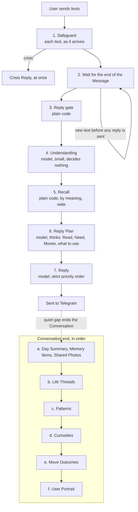

# How Zeph handles a message

Read this before planning or changing anything in the reply path, the Conversation-end steps or User Memory. Terms in **bold** are defined in `CONTEXT.md`; this file says how they fit together.

**Status:** target design, agreed on 19 Nov 2026 in a review of a real Conversation where Zeph brushed a User off mid-rant and only gave a useful Read after being pushed three times. It is **not built yet**, except where a "Built" note says a part now matches. "Today" notes say where the code still differs. Open points are listed at the end.

## What a reply is for

In every reply that matters, Zeph understands the User, forms an honest **Read** of what is really going on, **from the Outlook Admins wrote, never from views of its own**, and helps them move: with a view, a question that challenges, or a step. How the User is feeling decides when and how gently Zeph says it, not whether it has a view. Listening is how it gets there, not the goal.

The heart of it is **Patterns**: noticing what keeps showing up across a User's life and telling them at the right moment, so they see something about themselves they hadn't put into words. That is where they start questioning, and where Zeph is most useful.

## Decisions at a glance

Agreed in the 19 Nov 2026 review. Each is explained in the step below it applies to.

1. **Zeph always forms a Read** of what is really going on, from the **Outlook** Admins write (one piece of prose in the Persona, apart from its voice), never from views of its own.
2. **It says the Read** only when there's room, it's worth saying and it isn't a repeat; when the User asks for its view, it gives its deepest Read at once.
3. **Patterns** are their own kind of User Memory: what keeps showing up across a User's Threads, including what they keep choosing (their values). Suspected ones are hidden and offered only as Zeph's view; the User's reaction in chat confirms or closes them (ADR-0020). Confirming on the Dashboard is parked as a possible future Feature.
4. **One home per thing learned:** fact → Memory Item, story → Life Thread, recurring across stories → Pattern. The Portrait uses confirmed Patterns only.
5. **Nothing old is forgotten:** Threads are found by meaning however old; Patterns re-read the days behind their evidence (messages within retention, Day Summaries after); Summaries are thorough enough to stand in for deleted messages.
6. **A Message is everything before the pause:** a longer wait, and Zeph starts over if a text lands before any of the reply has gone out.
7. **Small one-job steps** (ADR-0021): Understanding (reads, decides nothing) → Recall (code, wide) → Reply Plan (Read, Need, Moves, what to use, whether a Check-in fits) → Reply. No fast path.
8. **Recall is wide, the reply is focused:** anything that comes to mind stays in mind for the Conversation; the Reply Plan picks what the reply uses. Patterns also come to mind directly in new situations.
9. **Said / read / unclear:** the Understanding keeps the User's words apart from Zeph's guesses.
10. **Check-ins are an option, never an order:** weighed in the Reply Plan; the separate Woven-in Check-in model goes.
11. **The Reply has a strict priority order,** with optional extras last.
12. **Every Admin-editable field explains itself** with a short hint.
13. **One Day Summary per User per day** (their time zone), rewritten from all of that day's messages each time a Conversation ends; replaces per-Conversation Summaries. A Conversation past midnight belongs to the day it started.
14. **Learning happens when a Conversation ends,** not after each reply.
15. **Knowing where the Conversation is going:** each Reply Plan says in a line where the Conversation is now and sees the earlier ones, so Zeph holds or pushes across the Conversation instead of flipping Need every message.
16. **Commitments are followed up:** one the User agreed to goes into its Life Thread with its date (seen by the User), plus a hidden Curiosity to ask how it went once the day has passed. Goals the User shows plainly are kept in Goals; ones Zeph only infers are Patterns.
17. **A friend who doesn't forget:** every reply sees all messages from the last 24 hours across Conversations, word for word; the Reply Plan has a tool to read a past day's messages within retention; after that, the Day Summary, Threads and Patterns remain. The Conversation and its quiet gap still bound Check-ins, limits and learning.
18. **Day Summaries carry feeling as well as facts:** what happened, how it felt and why, what it meant to them, how their mood moved, so a look back months later still makes sense. A **Day Summary Eval** checks it: the Judge answers questions about facts, feelings and what Zeph offered from the Summary alone (Evals cost money; run only on demand).

## The flow

Rule of thumb: each model call does **one job**. Rules that aren't judgment calls are plain code. Nothing optional reaches the reply as an order; it is weighed in the Reply Plan.

## Each step: what, why, how

### 1. Safeguard

- **What:** checks every text for crisis (suicide or self-harm, danger to others, abuse, medical emergency).
- **Why:** safety comes before everything, and a crisis must never wait for the rest of the Message.
- **How:** one model call per text as it arrives, read in the light of the Conversation. A crisis gets the Crisis Reply at once and a Safeguard Event; the rest of that Message isn't answered normally. When unsure, it treats the text as a crisis.

### 2. Wait for the end of the Message

- **What:** collects everything the User sends before pausing into one **Message**.
- **Why:** people say one thing across several texts ("haha / i get it / you know.. / … / what do you think?"). Answering each piece separately cuts them off and answers half a thought.
- **How:** waits after the last text for as long as it takes to type the next thought (Admin-set). If a text arrives while the reply is being written and before any of it has gone out, Zeph drops what it was writing and starts again with everything; a Woven-in Check-in already saved is taken back. Once part of a reply has gone out, a new text starts the next Message.
- *Built (20 Nov 2026): the wait is 15 seconds by default (`message_wait_seconds`; migration 0066 moved it from the old 4 only where an Admin hadn't changed it). A text checks in at once, even while a reply is being written. Until the first part of a reply is sent (after its typing pause), a new text drops it: nothing is sent, a saved Woven-in Check-in is taken back, and the Message is answered again with every text once the User pauses. The Message counts once toward the Daily Message Limit however many times it starts over. This works inside the in-memory per-User queue (ADR-0018). Before: a text sent mid-write waited behind the reply and started a new Message, so a 10-text rant got 5 replies, each landing mid-rant.*

### 3. Reply gate

- **What:** applies rules that are not judgment calls: the Daily Message Limit, Delete My Data confirmation, and similar.
- **Why:** account rules must be exact and the same every time; a model shouldn't decide them.
- **How:** plain code. It may stop the reply (e.g. the Limit Reply) or add a note for it (e.g. a data deletion step).

### 4. Understanding

- **What:** what the User said and means, how they feel and how strongly, what they want, whether they're struggling, whether they asked for a photo, and what past to look up. **It decides nothing about the reply.**
- **Why:** reading someone and deciding what to do about them are different jobs. Done in one call, they compete: the old combined call once wrote "don't reflect it back again" and picked Mirror in the same answer. Kept apart, the reading stays honest.
- **How:** one small model call, run on every Message however short, since "yep" is often the one that matters (no fast path). It sees the whole Message, every message from the last 24 hours across Conversations, earlier Understandings, and the User Portrait. For feelings and wants it keeps apart **said** (their words), **read** (a guess from how they said it) and **unclear**, so nothing guessed is treated as known.
- *Built (20 Nov 2026): the Understanding reads only (`core/understanding.py`, `understanding_prompt`). It is given the time, the User Portrait, earlier Understandings and the Conversation, and nothing to pick. It answers what they said and mean, feelings and wants each as said / read / unclear, mood and intensity, cause known, struggling, asked for a photo and look-up phrases. A failed or unreadable call falls back to an unclear, low mood whose cause is known. Today it sees the current Conversation, not yet every message from the last 24 hours (11). Migration 0067 reset `understanding_prompt` to the new seed, since the old one asked it to pick Needs and Moves.*

### 5. Recall

- **What:** brings to mind everything that might matter: Life Threads, Patterns, Memory Items, Knowledge passages, older Day Summaries, Move Outcomes, due Curiosities.
- **Why:** a Read needs the dots in one place before it can join them. The useful Read in the review joined three Threads (mum's visit, the job, the project) that were never in mind together.
- **How:** plain code, searching by meaning on what the Understanding says the User means, not only their raw words. Wide on purpose: whatever passes the closeness bar comes in, capped high only to protect cost. Patterns come in through their linked Threads and directly by closeness, so one can surface in a brand-new situation. Anything that came to mind earlier in the Conversation stays in mind until it ends.
- *Today: searches on the User's last 3 texts, and caps Threads at 3.*

### 6. Reply Plan

- **What:** decides what the reply does. First Zeph's **Read** of what is really going on, then the **Need**, the lead, supporting and next **Moves**, and what the reply uses from everything recalled (which Thread to bring up or leave alone, a Pattern, a Curiosity, Knowledge, a Shared Photo) and whether a due **Woven-in Check-in** fits at all.
- **Why:** this is where Zeph stops only mirroring and has something to offer. Every optional extra is weighed here against what the User needs right now, so nothing can hijack the reply. In the review, a separate Check-in model had the reply weave in a "present-moment pause" just as the rant ended, which the User took as being brushed off.
- **How:** one model call that thinks first. It is given the Persona's **Outlook** (how Zeph sees people and what helps them grow, written by Admins, so the same situation is read the same way every time), the Understanding, everything recalled, earlier Reply Plans in the Conversation, and the Needs and Moves Admins set. It has one tool: read a past day's messages word for word (within Message Retention), for when a Day Summary isn't detailed enough. A suspected Pattern may shape the Read, but is offered only as Zeph's view ("here's what I notice…"), never as fact. The plan has the reply say the Read only when there is room (not mid-vent, in crisis or light chat), it is worth saying (it adds something the User hasn't said) and it is not a repeat; when the User asks for Zeph's view, it gives its deepest Read at once (see **Read** in `CONTEXT.md`).
- *Built in part (20 Nov 2026): the Reply Plan is its own call (`core/reply_plan.py`, `reply_plan_prompt`, `reply_plan_model`, `reply_plan_thinking`, thinking on), saved in `reply_plans`. It is given the Understanding, the reminded Threads, due Curiosities, Move Outcomes, memory, the Needs and Moves (filtered by Features and limits), Ready Knowledge documents, earlier Reply Plans and the Conversation. It picks the Need, lead, supporting and next Moves with why, Threads to bring up (with why) or leave alone, Curiosities, Knowledge and a search phrase, Memory Categories, whether a Shared Photo may be sent and whether to ask why. The old code rules apply to its picks: Moves that ask a question, ask-why (never when the cause is known or twice in a row; when the plan doesn't say, a strong mood with an unknown cause asks), Curiosity raise limits, Thread hold-backs, a struggling User gets no photo unless they asked. A failed or unreadable call uses the fallback Need with no Moves and never asks why. Knowledge passages are fetched after it, from what it picked. Not yet: the Read and the Outlook (07), where the Conversation is, the past-day tool (11), Patterns (14), and weighing a Check-in (09): the separate Check-in model still runs after it, given the Understanding and the Reply Plan.*

### 7. Reply

- **What:** writes the texts the User gets.
- **Why:** the Read and the plan only help if the reply follows them, in Zeph's own voice.
- **How:** one model call with the Persona's voice, the Reply Plan, only what the plan picked to use, and every message from the last 24 hours across Conversations (Admin-set; on a very heavy day the oldest part is replaced by the Day Summary). Its instructions follow a strict priority order; when two clash, the higher one wins:
  1. Safety, privacy and the User's own boundaries (e.g. a Thread they asked Zeph to drop).
  2. What they just asked or need right now, from the Understanding. A direct question gets answered.
  3. The Reply Plan: the Need, the Moves, and the Read if the plan says to give it.
  4. What the plan picked from memory, used accurately; nothing suspected stated as fact.
  5. The Persona's voice: how Zeph talks, length, no lists.
  6. Optional extras: a Woven-in Check-in, a Curiosity, Knowledge, a sticker, a Shared Photo. Each is dropped if it doesn't fit.

  In the review, level 3 (give a real Read) would have beaten level 6 (a "present-moment pause"), so the brush-off couldn't happen.

  The Reply doesn't think first: the hard thinking happens in the Reply Plan, and the Reply writes it in Zeph's voice. The Admin switch (`response_thinking`) stays, to compare in an Eval if replies read flat.
- *Built (19 Nov 2026): the priority order (`write_instructions` in `core/response_composition.py`). Level 3 is the Reply Plan's guidance (the Need, the Moves, its guidance line, the Understanding's mood, ask-why note and Threads to bring up), level 1 holds the Threads to leave alone and the data deletion note, and level 2 holds the tools' instructions and Features not available. A due Woven-in Check-in comes from the separate Check-in model as an optional extra with a `bring_up_check_in` tool; if the Reply doesn't call it, the Check-in is taken back and stays due. In live runs (19 Nov 2026) the Reply nearly always left it out, so most due Check-ins go out on their own after the Conversation; once it brought one up without calling the tool, so that one wasn't logged and stayed due. Fixing this signal is part of 09.*

## When a Conversation ends

After the quiet gap (Admin-set), these run in order, each using what the earlier ones wrote. Everything here is User Memory except Curiosities. One home for each thing learned: **a fact is a Memory Item, a story is a Life Thread, and what keeps showing up across stories is a Pattern.**

### a. Day Summary, Memory Items, Shared Photos

- **What:** the Day Summary (one per User per day, rewritten from all of that day's messages each time a Conversation ends), changes to Memory Items (single facts), and which photos to keep as Shared Photos.
- **Why:** Message Retention deletes the raw messages (30 days today), so the Summary is what's left for every later look back and for Patterns.
- **How:** one model call, rewriting the day's Summary from all of that day's messages each time. It is written to stand in for the messages: the facts (who, what, numbers, decisions, what Zeph advised and how the User answered) and the feeling (how they felt and why, what it meant to them, how their mood moved and what moved it), not a vague list of topics. Threads, Patterns and the rest learn from the Conversation that just ended, so nothing is learned twice.
- *Built (19 Nov 2026): Day Summaries are kept in `day_summaries`, one per User and day. The call is given the day's earlier Conversations (for the Summary only) and the one that just ended (for Memory Items and photos too). Migration 0064 joined the old same-day Summaries without a model rewrite. The Dashboard's Copy still calls the tab "Conversation Summaries".*
- *Built (19 Nov 2026): the prompt keeps goals the User shows plainly in Goals, not only ones said word for word, and says which home each thing learned has.*

### b. Life Threads

- **What:** updates the stories this Conversation added to, and starts new ones.
- **Why:** Threads let Zeph follow someone's life across Conversations, and Patterns are built on them.
- **How:** one model call with the Threads this Conversation may touch.
- *Built (19 Nov 2026): a commitment the User agreed to (never one Zeph only suggested) goes into its Thread's story with the day it was due, and later how it went. The prompt says which home each thing learned has.*

### c. Patterns *(new)*

- **What:** adds evidence to Patterns that showed up again, starts suspected ones when the same way of thinking, feeling, acting or choosing shows up across two or more Threads, and confirms or closes one by how the User took a Read Zeph offered from it.
- **Why:** this is how Zeph comes to know someone more deeply than single facts allow, and how it learns their values (what they keep choosing). Confirmed Patterns are what Users discover about themselves on the Dashboard.
- **How:** one model call with the Threads this Conversation touched plus the User's other Threads closest in meaning, however old, open or settled (up to an Admin-set number), and the existing Patterns. It re-reads the days behind the evidence in play: their messages while retention keeps them, their Day Summaries after. Each piece of evidence is written to make sense on its own. Suspected Patterns stay hidden from the User (ADR-0020).
- *Built (20 Nov 2026): `PatternKeeper` in `core/patterns.py`, stored in `patterns` and `pattern_evidence` (migration 0066). It runs only when the Life Thread step started or changed a Thread (those are the Threads touched). The closest Threads have no closeness bar, only the Admin-set number (`pattern_keeping_threads`). It sees every Pattern the User has; the days it re-reads (`pattern_keeping_days`, newest first) are those behind the evidence of Patterns linked to the Threads it was given, each as that day's messages (leaving out the ended Conversation) or, once they are deleted, its Day Summary. Code holds the rules: a new Pattern needs evidence from two different Threads it was given; evidence names one of those Threads, dated by the model or else the day the Conversation started; a Pattern is confirmed or closed only with a reaction (agreed, pushed back, brushed off) judged from this Conversation, which also records when it was last offered, and this applies to a Pattern started in the same Conversation too; a closed Pattern never changes. A Pattern's linked Threads are the Threads in its evidence. Nothing uses Patterns yet: Users see them in 10, the Portrait and replies in 14. The Curiosity keeping prompt no longer asks for "a pattern you notice".*

### d. Curiosities

- **What:** questions to ask later: follow-ups (including how a commitment went, once its day has passed), gaps, look-backs, an unmade next Move.
- **Why:** this is how Zeph gets to know someone and follows up like a friend.
- **How:** one model call. Never made to check a Pattern: offering the Read is the check.
- *Built (19 Nov 2026): each new commitment gets a follow-up Curiosity, not before the day after it was due, on top of the usual one or so.*

### e. Move Outcomes

- **What:** how each Move went, in which situation and mood.
- **Why:** so Zeph learns what helps this User in which moments.
- **How:** one model call with the Conversation and the Moves each Reply Plan made.

### f. User Portrait

- **What:** a short, living picture of the User.
- **Why:** it goes into every Understanding and is what the User reads under "What I know about you".
- **How:** rewritten from Memory Items, Life Threads, confirmed Patterns only (Users see it), Move Outcomes and recent Summaries.

## Prompts: which step uses which, and how it is put together

Every prompt is an Admin-editable Platform Setting (key in `platform_settings`), with its own model and thinking switch beside it (`<step>_model`, `<step>_thinking`). Every model call is built the same way:

- **Instructions**: the step's prompt, with the **Persona** in front for calls that speak to the User. Admin data (Needs, Moves, Check-in Kinds, Memory Categories, Knowledge "when it helps") is written into the text by code.
- **Input**: either the Conversation as chat turns (the Reply only), or **one text that code builds** for the step, listing everything it is given (all other calls).

### Today

| Step | Prompt key | Persona in front? | Input, built by code | Where |
|---|---|---|---|---|
| Safeguard | `safeguard_prompt` | no | The Conversation as a transcript, ending with the new text | `core/safeguard.py` |
| Photo description | `photo_description_prompt` | no | The photo, its caption | `core/photos.py` |
| Understanding (reads only) | `understanding_prompt` | no | Time, Portrait, earlier Understandings, the Conversation | `core/understanding.py` (`describe_message_for_understanding`) |
| Reply Plan | `reply_plan_prompt` | no | Time, the Understanding, Needs, Moves and which each allows, Move Outcomes, Portrait, Goals, Memory Categories, recent Summaries, reminded Threads, due Curiosities, Knowledge documents, earlier Reply Plans, the Conversation | `core/reply_plan.py` (`describe_message_for_reply_plan`) |
| Woven-in Check-in | `woven_check_in_prompt` | **yes** | Check-in Kinds, local time, recent Check-ins, memory, the Conversation, the Understanding and the Reply Plan | `core/woven_check_ins.py` |
| Reply | `response_prompt` | **yes** | **Instructions** = Persona + `response_prompt` + the priority order with its clash rule + one section per level: 1. data deletion note, Threads to leave alone; 2. "answer a direct question first", each tool's instructions (web search, settings, sticker adding, photos), Features not available; 3. the Reply Plan's guidance (the Need's "how to reply", the Moves' "how to do it", its guidance line, the Understanding's mood, ask-why note, Threads to bring up); 4. memory text; 6. the Woven-in Check-in (with its `bring_up_check_in` tool), Curiosities, Knowledge passages. The Persona's voice (5) stays in front. **Input** = the whole Conversation as chat turns. | `core/response_composition.py`, guidance from `format_reply_guidance` in `core/reply_plan.py` |
| Check-in on its own | `check_in_prompt` | **yes** | Check-in Kinds, recent Check-ins, Shared Photos, due Curiosities, memory | `core/check_ins.py` |
| Conversation end a. | `memory_processing_prompt` | no | Memory Categories, current Memory Items, photos sent, moods through the day, the day's earlier Conversations, the Conversation that just ended. Writes the Day Summary. | `core/post_conversation.py` |
| Conversation end b. | `life_thread_keeping_prompt` | no | Today, the Threads it may touch, the Conversation | `core/life_threads.py` |
| Conversation end c. | `pattern_keeping_prompt` | no | Today, the Threads touched and the closest ones, every Pattern with its evidence, the days behind that evidence (messages or Day Summaries), the Conversation under the day it started | `core/patterns.py` |
| Conversation end d. | `curiosity_keeping_prompt` | no | Today, Memory Items, Threads touched, Curiosities waiting or raised, those asked recently, the unmade next Move, the Conversation | `core/curiosities.py` |
| Conversation end e. | `move_outcome_keeping_prompt` | no | The Moves each Reply Plan made, with the Understanding's mood, the Conversation | `core/move_outcomes.py` |
| Conversation end f. | `portrait_prompt` | no | Memory Items, Threads, Move Outcomes, recent Summaries | `core/user_portrait.py` |
| Personal Stickers (Conversation end) | `personal_sticker_keeping_prompt` | no | The stickers the User sent in the Conversation, in context, and the ones already kept | `core/personal_stickers.py` |
| Knowledge "when it helps" draft | `knowledge_when_it_helps_prompt` | no | The document's details and text | `core/knowledge.py` |

`memory_retrieval_prompt` is still in the database but no code reads it.

### Target

| Step | Prompt | Change |
|---|---|---|
| 1. Safeguard | `safeguard_prompt` | none |
| 4. Understanding | `understanding_prompt` | built: reading only (said / read / unclear), no Needs, Moves, Threads to raise or Knowledge to pick. Input: the Message, the Conversation, earlier Understandings, the Portrait. |
| 6. Reply Plan | `reply_plan_prompt` (built in part: no Outlook, Read or Check-in yet) | Instructions: the prompt + the Persona's **Outlook**. Input: the Understanding, everything Recall found, Needs and Moves, earlier Reply Plans in the Conversation, due Check-in Kinds. Output: the Read, Need, Moves, what the reply uses, whether a Check-in fits. |
| 7. Reply | `response_prompt` | Instructions: the Persona's **voice** + `response_prompt` + the Reply Plan + only what it picked, **in the fixed priority order** (built; level 3 is the Reply Plan's guidance). |
| Woven-in Check-in | `woven_check_in_prompt` | retired: folded into the Reply Plan |
| c. Patterns | `pattern_keeping_prompt` | built: Threads touched and closest, existing Patterns, the days (messages or Summaries) behind their evidence |
| a. Day Summary | `memory_processing_prompt` | built: rewrites the day's Summary from all of its messages, facts and feelings, to stand in for the messages |
| f. Portrait | `portrait_prompt` | confirmed Patterns added to its input |

Note the Persona: today it is in front of the calls that speak to the User and **not** in the Understanding. In the target, its **Outlook** goes to the Reply Plan (where the Read is formed) and its **voice** to the Reply.

## The Outlook

- **What:** the part of the Persona that says how Zeph sees people and situations and what it believes helps them grow. One piece of plain prose that Admins write, kept apart from the Persona's voice.
- **Why:** Zeph's Read must come from a direction Admins set, never from views the model makes up, so the same situation is read the same way every time and Admins decide who Zeph is. Each Persona has its own, so after the MVP a Buddhist Persona and a Stoic one read the same situation differently.
- **How:** an Admin edits it on the settings page with the rest of the Persona. It goes into the Reply Plan's instructions (where the Read is formed), and only there; the voice goes to the Reply. A change applies from the next reply.

## Admin-editable fields must explain themselves

Every field an Admin can edit for the pipeline (the Persona's voice and Outlook, each prompt, model and thinking switch, each limit, and each Need's, Move's and Check-in Kind's fields) shows a short hint under its label: **what it is, what it serves, and how it is used** (which step reads it, and when). One or two sentences, not a manual. For example, under the Outlook: *"How Zeph sees people and what helps them grow. Zeph forms its Read of each User from this before every reply. Plain prose."*

*Built (20 Nov 2026): every editable setting has a hint (`hint` is required on `EditableSetting` in `core/platform_settings.py`, and a test fails if one is empty or longer than two sentences), and the Admin settings API sends it with each setting. It shows under each field's name (13px, soft, as drawn in `web/design`); an editor (the Persona, each prompt, extra prompt and wording) gets its name and hint above it. Model and thinking switches share one hint each, under the step's heading. The Needs, Moves and Check-in Kinds pages show a hint under each field. Hints describe the pipeline as built today; settings added later bring their own.*

## Still to settle

- What is learned and when, including why Goals and Values & beliefs stay nearly empty.
- The exact fields of the Understanding and the Reply Plan.
- Parked for later: confirming suspected Patterns on the Dashboard (ADR-0020).

Related decisions: ADR-0016 (Needs and Moves), ADR-0017 (guesses are Curiosities), ADR-0020 (suspected Patterns), ADR-0021 (small one-job steps).
