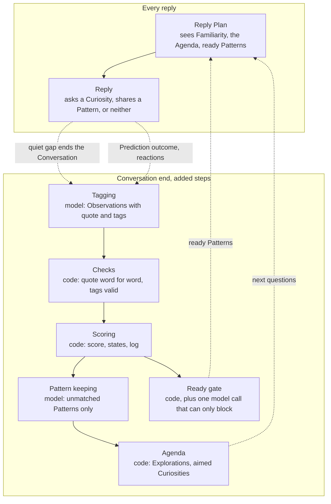

# How Zeph finds, tests and shares a Pattern

Read this before planning or changing Patterns, Observations, Curiosities, the Agenda or Thought Experiments. Terms in **bold** are defined in `CONTEXT.md`. The reply path itself is in `docs/message-pipeline/README.md`.

**Status:** target design, agreed 24 Nov 2026. **Not built yet**, except where a "Built" note says so. Every decision behind it, with starting numbers and the first fifteen Pattern Types, is in `.scratch/pattern-pipeline/grill-decisions.md`.

**Built so far:** the Pattern Catalog loads from `src/companion/seed/pattern_catalog/` when the backend starts, and Admins read it on the Dashboard's Pattern Catalog page (ADR-0025).

**Built (24 Nov 2026): Tagging and Checks.** `PatternTagger` in `core/observations.py` runs at Conversation end after Life Threads and before Pattern keeping, only while User Memory and the Feature **Pattern noticing** work (off for everyone to start). One model call (`pattern_tagging_prompt`, `pattern_tagging_model`, `pattern_tagging_thinking`, in the core services list) is given today, the Threads the Conversation touched (numbered), every current Pattern Type (signs for and against with their strength, look-alikes, what anyone would do), the tag lists and the Conversation, and answers `{"observations": [...]}`; an unreadable answer is asked once more. Code (`plan_observations`, pure) keeps an Observation only when: it names one Pattern Type in the catalog, or two different ones (unclear, the first one's sign); its sign is in the first Pattern Type's signs for when it is "for", or signs against when "against"; its quote is word for word in one of the User's own texts of that Conversation (text messages and photo captions; never the Companion's texts or a photo's description; runs of spaces and curly quotes evened out, nothing else, and never across two texts); relationship, power, setting and stance come from their lists or are empty; the kind of evidence comes from its list; it has a context line and who it is about; and it isn't an exact repeat. A Thread number it wasn't shown leaves it without a Thread. It is situational when its tags fit one of its Pattern Type's `anyone_would_when` tag matches (a new optional catalog field; for each tag a match names, the Observation's value is one listed; only CONF.AVOID.BELONG has them, from 0.2.0: strangers, or someone above them). Kept ones go in `observations` (migration 0082) with the Pattern Type versions, day the quote was sent (User's time zone), Thread, who, tags, kind, unclear and situational; they keep the quote with no link to its message, so Message Retention never deletes them; they go with their Thread, Delete My Data and Account Deletion. The Model Call Log's tagging call keeps `tagging_shape` (tagged, dropped), for every User, shown on the trace page as "Observations tagged" and "Dropped by code". Nothing reads Observations yet: no reply, Pattern or Dashboard page. Limits: the exclusion flag, linking to Patterns and scoring (issue 12), and the kept-quotes list (13) were still to come then (the Tagging Eval is built, below); the Admin Pattern Catalog page doesn't show `anyone_would_when` yet; ACH.WORTH.PERF's and CTRL.UNCERT.PLAN's "anyone would" (high stakes, a real crisis) can't be put as tags, so none of theirs is ever situational.

**Built (24 Nov 2026): Things you said that Zeph kept.** The Memories page has an eighth tab, "Things you said" (`?tab=quotes`, `KeptQuotesList`), listing every Observation's quote, Zeph's note (its context line, shown apart) and day, newest day first, with no Pattern Type or Pattern named; `GET /api/kept-quotes` and `DELETE /api/kept-quotes/{id}` (`UserMemoryService.list_kept_quotes`, `delete_kept_quote`) work whether User Memory is on or off. Deleting one scores the User's Patterns again at once (`observations_deleted`). Scoring and deleting a quote each lock the User's row (`Transaction.lock_user`) with their reads and writes, so a Conversation end already scoring finishes first and a deleted quote is never counted in a state saved after it. Telling Users first: `users.pattern_noticing_told_at` (migration 0085); `/api/me` says `show_pattern_noticing_notice` while Pattern noticing works for them and they haven't been told, and Home and Memories show the notice (`PatternNoticingNotice`, Shared Copy `shared.pattern_noticing.*`) until they press "Got it" (`POST /api/me/pattern-noticing-told`); the tagging step keeps nothing until then. One rule for every User, new or existing. Account's retention line adds `account.delete_data.kept_quotes`. Admins see a "Kept quotes" count on the Users panel when above 0 (`kept_quote_count`), never the quotes. Limits: tagging's insert isn't under the lock (safe while nothing tags a Conversation twice); the "Kept quotes" Admin row isn't drawn in `AdminUsers.html`.

**Built (24 Nov 2026): Scoring, states and the log.** `PatternScorer` in `core/pattern_scoring.py` runs right after tagging at Conversation end, while Pattern noticing works, and again at once when deleting a Life Thread removes Observations. A Pattern of a Pattern Type lives in the same `patterns` table as the unmatched ones (migration 0083: `pattern_type_id`, one per User and Pattern Type; the written `pattern` is empty for them); every old-style reader (Recall, Pattern keeping, the Patterns tab, the Portrait, deleting Patterns with no evidence) reads only rows with no Pattern Type, so nothing reaches a reply. Its Observations are the User's Observations naming its Pattern Type, first or second; any Observation makes a noticed Pattern. Pure rules (`plan_pattern_moves` and the functions it calls): an Observation is worth its sign's points (the sign in the current catalog version of its first Pattern Type, also when it counts toward the second) times its kind of evidence, cut to the unclear percent toward each of its two Pattern Types, nothing when situational, negative when against, and halved every half-life since its day. A situation is its Life Thread, or with none the same person (`about`, trimmed, any case) and setting; in it, for and against apart, only the strongest Observation per person counts, up to the cap of people. A situation counts toward "situations" only when its part for is above 0 and something other than a "what if" answer counts for it there (25 Nov 2026). The score is worked out when read and never stored; the state is. Under the floor → closed; at the suspected situations and score → suspected; else noticed. States follow the evidence, so moves go back too (suspected → noticed when evidence is deleted or fades, closed → noticed when the score comes back over the floor); a Pattern in ready, shared, confirmed or contested is never moved or deleted by scoring. A noticed, suspected or closed Pattern left with no Observations is deleted. Every move goes in the append-only `pattern_moves` log (User, Pattern, Pattern Type, from, to, cause `conversation_tagged` with the Conversation or `observations_deleted`, score and situations at the move, when), with no words of the User's; it stays when its Pattern is deleted and goes only with Delete My Data and Account Deletion. Numbers are whole-number Platform Settings with hints, in a Patterns section of Platform settings and overridable in Eval Variants: sign points 30 / 70 / 140 (decision 29's 1.0 is 100 points), kind of evidence 100 / 70 / 40 / 30 %, unclear 25 %, half-life 75 days, 3 people per situation, suspected at 2 situations and 100 points, closed under −150 points. Admins see how many Patterns each User has in each state on the Users page (a row per state with any, beside "Confirmed Patterns"; old-style Patterns are counted by their state too). Limits: shared, confirmed and contested were still to come then (built since, below, as are unmatched Patterns); the log has no Admin page yet; when a Pattern is deleted for having no Observations, no move records it; a sign missing from the current catalog version counts nothing.

**Built (24 Nov 2026): the Tagging Eval.** A ninth Eval kind, `tagging` (`core/evals/tagging_eval.py`), with no Judge. A case is a made-up ended Conversation, the Life Threads it touched and the Observations expected (Pattern Type, for or against, unclear, situational). The made-up User has Pattern noticing on and has been told; the Threads and Conversation are saved and `PatternTagger.tag_from` runs alone on them, with the Eval database's Platform Settings (a Variant can override `pattern_tagging_prompt`, `_model`, `_thinking`) and the Pattern Catalog, which the Eval database now loads from its files for every case. `plan_observations` now returns each dropped entry with its `DropReason`, and `tag_from` returns what it planned. A case passes only when every expected Observation is matched by a kept one (same direction, unclear and situational; the Pattern Type is its first or, when unclear, either of its two) and every kept one matches one expected; several kept quotes may match one. The Case Result's `tagging` part (expected with matched, kept, dropped with why) is shown on the Dashboard (`TaggingObservations`; reference `web/design/reference/AdminEvalTaggingCase.html`). 44 seed cases in `seed/evals/cases/tagging.yaml`, drafted for the owner to correct. `make eval` now prints the estimate before queueing. What the Pattern Evals can and can't show, and what must be done later: `docs/pattern-evals/README.md`.

**Built (24 Nov 2026): Explorations and the Agenda.** Behind the Feature **Pattern exploring** (off for everyone to start; works only while Pattern noticing works, shown as "Off: Pattern noticing is off for this user"). `AgendaKeeper` in `core/agenda.py` runs at Conversation end after Curiosities, while Pattern exploring and Curiosities work, with the User locked like scoring. No model call. Pure rules (`plan_agenda` and the functions it calls): every aimed Curiosity asked is judged (`try_outcome`): brushed off or asked to drop → brushed off; the unclear story it aimed at now clear → useful; engaged and an Observation of its Pattern Type came from that Conversation → useful; else vague. Each suspected Pattern gets an Exploration (`explorations`, migration 0088, goes with its Pattern). One rests after `exploration_rest_after_tries` (4) tries with nothing in a row (counted since it last woke) or at once when asked to drop, closing its waiting aimed Curiosity; a resting one wakes when an Observation of its Pattern is tagged after it rested. The rest, while their Pattern is suspected, are ranked by score, then oldest, and the top `agenda_size` (3) are active. Open needs (`open_needs`), from the Pattern's Observations: unclear stories, newest first; a part of life (home, work, with friends) with no Observation while another has one; a counter-test, open until an Observation against comes or a counter-test try was useful. For each active Exploration with no waiting aimed Curiosity, not tried in the Conversation that just ended (so never two Conversations in a row), code writes one for the top need (`aimed_question`): a plain instruction from the story's day and context line, the Pattern Type's "if" and the part of life, never the Pattern's name or the User's quote; least pushy way first (story follow-up → "would it have gone differently with…" → "this week, notice when…"), a different way after a try with nothing, not before the last try's day + `exploration_wait_days` (3) after a try with nothing. A waiting one no longer aimed at the top need is closed and replaced. Each try is kept in `exploration_tries` (need, way, Observation or part of life aimed at, outcome); when and where it was asked are its Curiosity's (`curiosities.exploration_id`, `source_observation_id`; deleting the Exploration or the Observation deletes the Curiosity and its try). `AgendaReader` gives the Reply Plan the active Explorations in rank order on every reply (none while struggling): each Pattern Type's name and if/then, marked never to say, its open needs and earlier tries (day, way, question, outcome), and a line to aim a question-asking Move at an open need; the Reply gets the open needs in plain words when its lead or supporting Move asks a question. Aimed Curiosities come first among the due ones, also for Curiosity Check-ins, and none is offered while Pattern exploring is off; the Curiosity keeping step never sees, edits or closes waiting aimed ones, and they don't count toward the waiting limit. The tagging step is shown the unclear stories an aimed Curiosity asked about in the Conversation and may answer `settled`; code (`plan_settled`) keeps one only for one of its two Pattern Types and a sign of it in the same direction, and makes the Observation clear. Migration 0088 reloads `pattern_tagging_prompt` and `reply_plan_prompt` from the seed. The three numbers are in the Patterns section of Platform settings with hints and overridable in Eval Variants. Turning Pattern exploring off makes and deletes nothing. Delete My Data and Account Deletion remove Explorations and tries. Limits: an Observation from earlier in the same Conversation can make a try useful; a Check-in that asks an aimed Curiosity with no reply counts as a vague try; deleting a story deletes the tries aimed at it, so their count and a met counter-test can start over; Admins see no Explorations yet.

**Built (24 Nov 2026): Thought Experiments.** Admins manage them on the Dashboard's Thought Experiments page (`/admin/thought-experiments`, `ThoughtExperimentService` in `core/thought_experiments.py`, `thought_experiments` table, migration 0094): wording, the two Pattern Types it tells apart, sensitivity, starter and on, each with a hint; add, edit, switch off and archive, never delete. A pure check on save (`leading_flags`) refuses wording with phrases that suggest the answer or words that make one choice sound bad, unless the Admin presses "Save anyway". The first 31 come from `seed/thought_experiments.yaml` by `key`: one whose key is stored is never touched again. An Exploration's ways are now story follow-up → "would it have gone differently with…" → Thought Experiment → "this week, notice when…"; the Thought Experiment way is used only for an unclear need, while fewer than `thought_experiments_per_pattern_per_week` (1) were asked or are waiting for its Pattern in 7 days, and when `pick_thought_experiment` finds one: for the look-alike pair with the most unclear stories of that Pattern (then the next pair), on, not archived, never put to the User, oldest first. Otherwise the next way is used. It becomes an aimed Curiosity telling the reply to put the situation "keeping its words", with its sensitivity, and its try keeps `thought_experiment_id`. So it is asked in chat or by the Curiosity Check-in Kind like any aimed Curiosity. Switching one off or archiving it closes its waiting Curiosities at once. At Conversation end the tagging step is shown the questions that put one to the User, numbered; an Observation answering one gives its number and code makes it a "what if" answer. The Thought Experiment's Curiosity is aimed at the unclear story, so an answer that tells the two apart can settle that story, as with any aimed Curiosity. Admins see how many times each was asked. Guide: `docs/thought-experiments/README.md`. Limits: the leading check is a word list.

**Built (25 Nov 2026): Familiarity and starter Thought Experiments.** **Familiarity** (`core/familiarity.py`, `users.familiarity`, migration 0095) is new, getting to know or knows well. `FamiliarityKeeper` works it out at every Conversation end, after scoring and Pattern keeping (also while User Memory is off), whatever the three Pattern Features say. No model call. One pure function (`familiarity_of`) from four counts (Conversations, Life Threads, Observations from real stories, Patterns in each state, with or without a Pattern Type) against Admin-set bars: knows well with a Pattern shared or confirmed; getting to know when every bar is met (`familiarity_conversations` 5, `familiarity_life_threads` 3, `familiarity_real_stories` 0, which means none needed) or with a Pattern suspected, ready or contested; new otherwise. It follows the counts, so it can go back; Delete My Data makes a User new again. The Reply Plan is told it in one line on every reply ("How well you know them (Familiarity): new"), and `reply_plan_prompt` (reloaded from the seed by the migration) says what each level means for how Zeph asks. Admins see it as the first row of "What Zeph holds" on the Users panel. **Starter Thought Experiments** (`core/starter_thought_experiments.py`): right after the Agenda, while Pattern exploring and Curiosities work, code (`plan_starters`, pure) writes a new User's next starter as a waiting Curiosity with the aim `starter` and `curiosities.thought_experiment_id`: the oldest Thought Experiment marked starter that is on, not archived and never put to them (as a starter or by an Exploration), until `starter_thought_experiments` (4) were asked or wait, only for `starter_thought_experiment_days` (14) after they signed up, and never more waiting than `starter_thought_experiments_per_conversation` (1). One is written only when a Conversation ends, so a Conversation asks at most that many, and the first comes in the second Conversation. It is asked like any Curiosity, under the usual Need rules, pace and limits, in chat or by the Curiosity Check-in Kind; it comes first among the due ones, and is offered only while Pattern exploring works, the User is still new and the days haven't passed. They stop once the User is getting to know, the days have passed or the User asked Zeph to drop one: the waiting ones are closed at the next Conversation end. Switching a Thought Experiment off or archiving it closes its waiting starter at once. The tagging step is shown a starter that was put like any Thought Experiment, so its answer is a "what if" answer. **Weak evidence, by a scoring rule:** a situation counts toward "situations" only when something other than a "what if" answer counts for the Pattern there, so "what if" answers add points but alone never make a Pattern suspected (or, later, ready). This holds for every Thought Experiment answer, not only starters. The Agenda never puts a Thought Experiment that was already a starter for that User. Onboarding is unchanged. The six numbers are in the Patterns section of Platform settings with hints, and overridable in Eval Variants. Limits: a User signed up before this is new until their next Conversation ends; the days count from sign-up, not from the first Conversation; a User who drops back to new inside the days is offered starters again, up to the same number; the answer is weak evidence only when the tagging model marks it as answering the Thought Experiment it was shown; a Curiosity Check-in may also put a waiting starter; the keeping model never sees or edits a waiting starter.

**Built (25 Nov 2026): the ready gate.** `ReadyGate` and `ReadyKeeper` in `core/ready_gate.py` run right after scoring at Conversation end, while Pattern noticing works. Nothing is shared here: sharing is its own step (below). For each suspected or ready Pattern, code works out the facts (`gate_facts`, pure) and one pure function, `ready_check`, names the first of the ten checks it fails, or none. In the order they are judged: **situations** (the Admin-set number, or the Pattern Type's `situations_needed` when that is more); **Conversations** its evidence for comes from; **counter-test** (asked and answered, as the Agenda counts it: an Observation against came or a counter-test try was useful, and the evidence against stays under the bar); **score**; **clear** (its clear Observations alone reach the situations and score too); **situational** (the same without any Observation where anyone would act the same by the catalog now, so a rule added after tagging counts); **safe**; **allowed** (its Pattern Type is approved; a Pattern the User rejected will be contested, which the gate never looks at, issue 08); **quotes**; **other side**. The last two cost more, so they are looked at only when the eight before pass: every quote is read again against its Conversation's texts still kept (one whose texts Message Retention deleted was checked at tagging and counts as checked), then one model call (`pattern_other_side_prompt`, `_model`, `_thinking`; core service "Other side"; step `pattern_other_side` in the Model Call Log) is given the Pattern Type with its look-alikes and what anyone would do, where it was narrowed and every Observation, and answers `{"better_explanation": true | false, "why": "..."}`. A yes, an answer unreadable twice or a failed call blocks. Its last readable answer is kept with the Pattern (`other_side_asked_at`, `other_side_found_better`) and stands for the same evidence: it is asked again only once an Observation of that Pattern is tagged after it, so a Pattern taken back for a passing reason (a Safeguard Event, an exclusion) becomes ready again with no new call. The model is asked outside the User's lock; the Pattern is then judged again under it, and if its Observations are no longer the ones looked at, the last two checks count as not made and it waits for the next Conversation end. **Narrowing** (`narrowings_of`, pure): when the clear evidence against is all with other kinds of people (relationship, or where they stand) than any clear evidence for, the Pattern is narrowed ("shows with family, friend, not with partner"), saved on it (`patterns.narrowings`), and that evidence against isn't counted against it. **Safe** means: no exclusion of its Pattern Type applies, no Safeguard Event within `pattern_safeguard_quiet_days` (14), and no Observation of it on a ruled-out topic the User didn't raise. **Exclusions:** the tagging step is now also given each Pattern Type's exclusions, the User's open Life Threads and their latest Day Summaries (`pattern_exclusion_summary_days`, 7) and answers `exclusions` (Pattern Type and exclusion); code keeps one only when that Pattern Type lists it, and each tagging replaces the User's flags (`pattern_exclusion_flags`). While one applies its Pattern is never ready; when its evidence is `ignored`, Observations tagged then are kept but marked `excluded` and carry no weight, ever. **Ruled-out topics:** Admins edit the list on Platform settings (`pattern_ruled_out_topics`; a first list of four, for the owner to correct); the tagging step is given it and marks an Observation's `ruled_out_topic` and `raised_by_user`; code keeps a topic only when it is on the list. **The log:** a Pattern keeps the check that last stopped it (`patterns.blocked_by`); the move to ready records it, and a move back from ready records the check it now fails (`pattern_moves.blocked_by`). **Going back:** a ready Pattern is judged again at every Conversation end and at once when Observations are deleted or tagged again (no model call), and one that fails, or whose Pattern Type left the catalog, goes to where its score puts it (suspected, noticed or closed). The seven numbers and the list are in the Patterns section of Platform settings with hints, and overridable in Eval Variants. Migration 0098 reloads `pattern_tagging_prompt` from the seed. Delete My Data and Account Deletion remove the flags. Limits: a flag stays until the User's next tagged Conversation; scoring still counts evidence against that only narrows, so it can pull a Pattern under the suspected bar, where the gate doesn't look; any Observation against counts as an answered counter-test, asked or not (the Agenda's rule); a topic added to the ruled-out list doesn't reach Observations tagged before, and the list can't be emptied; a past Conversation tagged again is never marked excluded; between two looks a ready Pattern can be stale (a Safeguard Event mid-Conversation, fading), so sharing looks again; struggling is not looked at here (sharing does); a contested state and "the User rejected it" are built with sharing, below; an archived Pattern Type is treated like a draft; the other-side call sees the User's quotes, like tagging; the Tagging Eval's cases don't cover exclusions or ruled-out topics yet; Admins see the ready count only, not which check blocks.

**Built (25 Nov 2026): sharing a ready Pattern.** Behind the Feature **Pattern sharing** (off for everyone to start; works only while Pattern exploring works, shown as "Off: Pattern exploring is off for this user"; a Feature now also counts as off when the one it needs is off because of the one before). `PatternSharing` in `core/pattern_sharing.py`. **Offered:** before each reply, while they aren't struggling and fewer than `patterns_shared_per_week` (1) Patterns were shared with them in the last 7 days (counted from the log of moves, so a deleted Pattern still counts), code looks again at the User's ready Patterns (`ReadyKeeper.still_ready`, no model call; one that now fails goes back, cause `looked_before_sharing`) and offers the Reply Plan the one ready the longest: its Pattern Type's approved wording, where it shows ("It shows with family, friend; not with partner."), and two or three quotes picked by code (`pick_quotes`, pure): one per situation, only clear evidence for it from their own life that carries weight (not excluded, not situational, not a "what if" answer, not on a ruled-out topic they didn't raise), real stories first, newest first. Fewer than two such quotes and it isn't offered. Nothing more is read for a User with no ready Pattern. The form's `share_pattern` picks the moment; code keeps it only when a Pattern was offered. A reply that tells them a Pattern asks nothing else: no asking why, no Curiosity, no Move that asks a question. **Told:** the Reply gets it at level 3, as part of the plan, in three parts: the Pattern in warm words fitted to their people, two or three of the quotes word for word, and one Prediction from the Pattern Type's wording, then "ask them what would prove it wrong"; as Zeph's view, never a fact, with no clinical words. **Checked:** once the reply is sent, one small call (a fixed prompt in code, `SHARED_CHECK_PROMPT`, on `check_in_model` without thinking; step `pattern_shared_check`) reads the reply and answers `{"shared": true | false, "prediction": "..."}`. Only on a yes does the Pattern move ready → shared (logged, cause `shared_in_chat`, `patterns.shared_at`), under the User's lock and only if it is still ready; the Prediction as the reply worded it is kept in `predictions`. A no, an unreadable answer or a failed call leaves it ready, and it doesn't count toward the limit. The Reply Plan's shape records `pattern_to_share_offered`, `pattern_share_planned` and, after the check, `pattern_shared`, shown on the trace page as "Pattern to share". **As a Check-in:** a new Check-in Kind with fixed behaviour, "Something I've noticed" (`check_in_kinds.shares_pattern`, seeded and added by migration 0100), may be sent only when a ready Pattern has waited `pattern_share_wait_days` (5) since it became ready, Pattern sharing works and the weekly limit isn't reached. Then the Pattern is looked at again, and if it can be shared, only that Kind is offered, with the three parts; never when their last Message read as struggling. Once the Check-in is sent the same check runs on its message, and the move is logged with cause `shared_in_check_in`. Users see that Kind on their Check-ins page only while Pattern sharing works for them. **Reactions:** the tagging step is shown the Patterns Zeph has told them (shared, confirmed, contested), numbered, in the words they were told, and answers `reactions` (agreed, pushed back, brushed off); code keeps one per Pattern and Conversation (`pattern_reactions`, no words of the User's). Agreeing is a weak sign for and pushing back a weak sign against, fading like any evidence (`reaction_points`, pure), so agreeing adds up and never confirms by itself. Right after tagging, code (`settle_reactions`) makes a shared Pattern they pushed back on **contested**, logged with cause `user_reacted` and its score with reactions counted. A contested Pattern is never ready again (the gate doesn't look at it), so it is never offered; the Reply Plan is shown it as "Patterns you told them that they disagreed with. Never bring one up", and may answer `raised_pattern` only when they raise it themselves, in which case the reply may talk about it, without pressing. **The User's switch** (`users.contested_gathering_enabled`, on to start): "Keep noticing after I disagree" on Account & privacy, shown while Pattern sharing works for them, and in chat with the settings tool `turn_noting_on_disagreed_patterns_on_or_off` (marked "Changed in chat"). While off, the tagging step's code drops any Observation naming a Pattern Type they disagreed with, before or in that same Conversation (counted under "Dropped by code"). The matching command's tagging again keeps none for those either. With the switch off, a reaction to a contested Pattern is kept only when they push back again. A push-back that a failed run left unsettled is settled at the next Conversation end. The two numbers are in the Patterns section of Platform settings with hints, and overridable in Eval Variants. Migration 0100 reloads `pattern_tagging_prompt`, `reply_plan_prompt` and `reply_settings_instructions` from the seed. Delete My Data and Account Deletion remove Predictions and reactions with their Patterns. Limits: the check runs after the reply is sent, so a failed check on a reply that did tell them leaves the Pattern ready and it may be told again; a reply only partly sent is never checked; the quotes the reply used aren't stored, only the Prediction; reactions are read when the Conversation ends, so a rejection takes effect then, and only while User Memory and Pattern noticing work; a reaction counts in the score only where the score is read with reactions (the contested move, and confirming or closing a shared Pattern, below); agreeing with a contested Pattern is kept as a reaction but doesn't bring it back; a Check-in's Pattern goes out at their next Due Time after the wait, not at the wait itself, and the Check-in model may still skip; with Check-ins off it waits for a moment in chat; the Check-in prompt wasn't changed, the section given with the Pattern says it may be longer and quote them; the Memories page's Patterns tab doesn't show shared Patterns yet (issue 18), and the Prediction is followed up by the step below.

**Built (25 Nov 2026): following up a Prediction, and confirming.** `PredictionKeeper` in `core/predictions.py`; the pure rules are `plan_follow_ups`, `shared_pattern_facts` and `shared_move`. **Follow-up:** when a Conversation ends, after the starter Thought Experiments and only while Pattern sharing and Curiosities work, code writes one Curiosity with the new aim `prediction` for each shared Pattern's newest open Prediction (`curiosities.pattern_id`, `prediction_id`): asked not before `prediction_follow_up_wait_days` (7) and not after `prediction_follow_up_drop_days` (21), both counted from when the Prediction was given, or from when the User last said it hasn't come up. The last day is kept on the Curiosity (`curiosities.not_after`, new, for any Curiosity), so a late one is never offered, in chat or as a Curiosity Check-in. It carries the Pattern's approved wording, where it shows and the Prediction as it was given, since the Reply Plan isn't shown shared Patterns. It is offered first among the due ones, only while Pattern sharing works, under the usual Need rules, pace and limits; the keeping model never sees or edits it. No model call. **Dropped:** a Prediction with no answer by its last day (never asked, or asked once and not answered) gets the outcome "not followed up", which counts nothing, and its waiting Curiosity is closed. **Outcome:** the tagging step is shown the open Predictions of the User's shared Patterns, numbered, with the day each was given, and answers `prediction_outcomes` (came true, didn't, hasn't come up); code (`plan_prediction_outcomes`) keeps one per Prediction it showed, in `predictions.outcome` and `outcome_at`. It reads them whether or not Zeph asked, so a User who reports it unasked counts too. Came true is one strong sign for the Pattern and didn't one strong sign against, fading like any evidence (`prediction_points`); hasn't come up adds nothing, keeps the Prediction open and starts a new wait from that day. **Confirm or close:** right after reactions are settled and before scoring, `settle_shared` scores each shared Pattern from its Observations, its reactions and its Prediction outcomes. Under `pattern_closed_under_points` → closed. Else `predictions_to_confirm` (2) came true → confirmed. Else the Observations tagged after it was shared reach `pattern_confirm_points_after_sharing` (300) by themselves → confirmed. Each move is logged (cause `conversation_tagged`) with a new `pattern_moves.reason`: `predictions_came_true`, `strong_evidence_after_sharing` or `score_under_floor`. A Pattern closed after it was shared stays closed for good: scoring never moves or deletes it (`is_moved_by_score`). **New Prediction:** a shared Pattern with no open Prediction (the last was settled or dropped, or the sharing reply gave none) gets a Curiosity telling the reply to offer one new thing to watch for, from its Pattern Type's `prediction_wording`. After a reply or Check-in that brought it up, one small call (a fixed prompt in code, `GIVEN_CHECK_PROMPT`, on `check_in_model` without thinking; step `prediction_given_check`) answers `{"given": true | false, "prediction": "..."}`; only on a yes is the Prediction kept, as worded. Once the User asked Zeph to drop a Curiosity about a Pattern's Prediction, nothing more is written for that Pattern. **Portrait:** the Portrait's input lists the confirmed Patterns of Pattern Types in their approved wording with where they show, under "Patterns they agreed with"; a shared one isn't listed. The four numbers are in the Patterns section of Platform settings with hints, and overridable in Eval Variants. Migration 0101 reloads `pattern_tagging_prompt` from the seed. Limits: a shared Pattern is judged only when a Conversation ends, not when a quote is deleted; one story can count twice, as a Prediction outcome and as an Observation the tagging step writes from the same words; a Pattern Type has one Prediction wording, so a new Prediction is much like the last; the Reply Plan may pick another due Curiosity, and a reply may not ask one it picked, which still counts as asked (as for any Curiosity); a new Prediction not kept by the check is offered again after the next Conversation end; a confirmed Pattern is never closed or moved again, and nothing but the Portrait and Familiarity reads it yet (the Reply Plan isn't shown shared or confirmed Patterns); with the starting numbers a shared Pattern can hardly fall under the floor from Predictions alone; a contested Pattern's Predictions are left as they are; Admins see counts only; the Tagging Eval's cases don't cover Prediction outcomes.

**Built (24 Nov 2026): the full first catalog.** Fifteen Pattern Types, three per area (decision 30), approved by the owner (Zaf) on 24 Nov 2026, in `src/companion/seed/pattern_catalog/`. The twelve new ones are at 0.1.0; CONF.AVOID.BELONG (0.3.0), CTRL.UNCERT.PLAN (0.2.0) and ACH.WORTH.PERF (0.2.0) gained look-alikes. Every look-alike pair is named both ways, and a test checks it, and checks no clinical terms are used outside `frameworks`. `anyone_would_when` is now also set for CONF.DEFEND.SELF (a hostile stance), CONF.WITHDRAW.HURT, APPR.HIDE.BURDEN and REL.DISTANCE.INDEP (strangers and acquaintances), and APPR.GIVE.NEEDED and APPR.CONFIRM.CHOICE (someone above them at work). The Tagging Eval seed has 24 more cases, one for and one against each new Pattern Type (68 in all). How to change or add a Pattern Type, and what each change does: `docs/pattern-catalog/README.md`.

**Built (24 Nov 2026): unmatched Patterns and moving the old ones across.** `PatternState` gains `unmatched`: the state of a Pattern with no Pattern Type that the keeping step wrote. It is apart from the seven states code moves a Pattern of a Pattern Type between. Migration 0092 makes the suspected Patterns kept before the catalog unmatched (hidden, as before), with all their evidence; it also reloads `pattern_keeping_prompt` from the seed. **Pattern keeping** (`PatternKeeper` in `core/patterns.py`) now only notes unmatched Patterns: it is shown the Pattern Types (name, if / then / function, definition, no IDs) so it leaves those to tagging (only for a User tagging runs for: Pattern noticing works and they pressed "Got it"; otherwise it is shown none, so what recurs is still kept somewhere), starts an unmatched Pattern only with evidence from two or more Threads, and adds evidence only to unmatched ones. It no longer reads how the User took a view, and never confirms or closes; whatever state or reaction the model writes is ignored, and it never sees a Pattern of a Pattern Type. It runs whether Pattern noticing works or not. **In replies** an unmatched Pattern still comes to mind (through its Threads or by meaning) and the Reply Plan may build its Read on it, marked "never offer it or say it as a pattern"; code drops `offer_pattern` unless the Pattern is confirmed. **Matching** (`PatternMatcher` in `core/pattern_matching.py`) runs only from the Admin command `make match-patterns` (`python -m companion.pattern_matching_terminal`, `TYPES=ID,ID` to match against only some Pattern Types, e.g. ones just added). For each Pattern with no Pattern Type and no match yet, one model call (`pattern_matching_prompt`, `_model`, `_thinking`, in the core services list; step and trace kind `pattern_matching` in the Model Call Log) is given the Pattern Types and the Pattern with its evidence and answers `{"pattern_type": "<ID>" | null}`; an unreadable answer is asked once more; code keeps the answer only when the ID is one it was given. A match is a link (`patterns.matched_pattern_type_id`), saved once its evidence was tagged again, so a run that fails part-way is done again by the next: the Pattern keeps its words, state and evidence, and once linked is not asked about again. Then, for matched Patterns, each Conversation started on a day of their evidence whose messages Message Retention still keeps is tagged again (`PatternTagger.tag_again`) against only the Pattern Types matched that day, with the evidence's Threads, under the same checks as any tagging (word-for-word quote, sign, tags); an Observation already kept from that Conversation (same Pattern Type, sign and quote) isn't kept twice. New Observations score the User's Patterns again (cause `evidence_tagged_again` in the log), so a Pattern of that Pattern Type is noticed the usual way. Only Users for whom Pattern noticing works and who pressed "Got it" are looked at; the rest are reported as skipped and left for a later run, and one User failing doesn't stop the others. The command prints IDs and counts (Patterns looked at and matched, Conversations tagged again, Observations kept, evidence days with no messages left), never a User's words, and exits 1 when a User's run failed. Admins see an "Unmatched Patterns" count per User. Limits: evidence whose messages are already deleted can't become Observations (they need the User's exact words); a Pattern keeps its first match, so it is not checked against Pattern Types added later; a matched Pattern and the Pattern of that Pattern Type are two rows, joined only by the link; the general description and the Admin review page are built, below.

**Changed (25 Nov 2026): the Patterns kept before the catalog are removed.** The owner chose to start fresh (pattern-pipeline issue 24). Migration 0097 deletes the confirmed and closed Patterns with no Pattern Type, with their evidence, so a Pattern with no Pattern Type is always unmatched. Unmatched Patterns and Patterns of Pattern Types are left alone. What only the old ones used went too: how the User took an offered Pattern and when it was last offered (`patterns.last_reaction`, `last_offered_at`, `PatternReaction`), the wait after a push-back (`pattern_pushed_back_wait_days`), and the matching command's rule for closed Patterns. Left in place but idle until issues 08, 09 and 18 rewire them to Patterns of Pattern Types: `offer_pattern` in the Reply Plan (code drops it unless the Pattern is confirmed, and none is), the Memories page's Patterns tab (shows its empty state) and the Portrait's "Patterns they agreed with" (none).

**Built (25 Nov 2026): Admins review what keeps turning up unmatched.** The Pattern keeping step now also writes a `general` line with each unmatched Pattern it starts: one short sentence on the way of acting, in words that could be true of anyone ("Makes jokes when things get serious"), with no names, people, places, dates, numbers or quotes. An unmatched Pattern kept earlier with none is marked "needs a general description" in what the model reads, and gets one the same way; once kept it is never rewritten. Code (`read_general_description` in `core/unmatched_review.py`) drops one holding a digit, a quote mark, a capital letter after its first word (a person, a place, a company, a month) or the User's name; the Pattern is still kept and asked about again at the next Conversation end. It is saved as `patterns.general_description`. **Grouping** (`UnmatchedGrouper`): right after keeping, each unmatched Pattern with a description and no entry yet is embedded and joins the unmatched entry closest in meaning, if one is at least as close as `unmatched_grouping_closeness_percent` (80, Patterns section of Platform settings); otherwise a new entry starts with that description (`join_or_add`, one at a time across the platform under a database lock, so two Conversations ending together never start two entries for the same thing). An entry (`unmatched_entries`, migration 0096) holds only the first general description, its embedding and an Admin's mark: no User ID, and never a Pattern's own words or evidence. The link is `patterns.unmatched_entry_id`. **The count** is Users with an unmatched Pattern under the entry that the matching command hasn't linked to a Pattern Type; a User counts once, and an entry with no Users left isn't listed (it stays stored, so its mark holds if it turns up again). **Marks** (`UnmatchedReviewService`): to review, new Pattern Type, folded (naming a Pattern Type in the catalog) or dropped, saved with the User count at that moment. A dropped entry reads as to review again only when it appears for more Users than when it was dropped. A mark changes nothing else: writing the YAML stays manual, and after it the Admin runs `make match-patterns TYPES=ID`. **Admins** use `/admin/unmatched-patterns` (`GET /api/admin/unmatched-patterns?mark=`, `PUT /api/admin/unmatched-patterns/{id}/mark`): filter pills by mark, one card per entry with its description, mark and Users, most Users first. Migration 0096 reloads `pattern_keeping_prompt` from the seed and removes no User data. Limits: the code check can't catch every telling detail (a job or a place written without a capital), so the prompt carries the rest; an entry keeps the words of the first description grouped under it; the embedder can't tell opposites apart ("makes jokes" and "stops joking" score about 91) and a loosely worded paraphrase can score under the bar (the same way in other words scores about 74 to 88, a different way up to about 78), so some entries will be lumped or listed twice; a dropped entry is judged only by its count against the count when dropped, so Users leaving and others arriving at the same number don't bring it back; changing the bar doesn't regroup entries already made; an entry added just before its Pattern failed to save stays with no Users, unlisted; an entry with one User, read beside the per-User "Unmatched Patterns" count, can point at that User on a small platform; the model that suggests Pattern Types from this list is parked (`.scratch/pattern-pipeline/grill-decisions.md`).

## What it is for

Zeph helps a User see their own patterns. It turns everyday conversations and Thought Experiments into evidence-backed Patterns about how they act in different situations, and they test them in their own life.

Two rules run through all of it:

- **The model reads and words; code decides.** A model tags what a User said, words a question and words a shared Pattern. Code checks, scores, moves states and decides what may be shared. Prompts hold no numbers.
- **Zeph is proactive, the gate is strict.** Zeph digs, asks and has opinions freely. The gate limits only what it claims about who a User is.

## The flow

Tagging runs after the Life Thread step, since an **Observation** needs its Thread.

## Each step

| Step | Who | What it does |
|---|---|---|
| Tagging | Model | Reads the Conversation, the Threads it touched and the whole **Pattern Catalog**. Writes **Observations**: Pattern Type and sign, for or against, the exact quote, who it's about, situation tags, kind of evidence, a context line. Names two Pattern Types when it can't tell (unclear). |
| Checks | Code | Drops any Observation whose Pattern Type or sign isn't in the catalog, whose quote isn't word for word in the User's own texts, or whose tags aren't from the fixed lists. Drops are counted in the Model Call Log. |
| Scoring | Code | Adds up weights with fading. Counts situations (one per Life Thread; different people within one add weight). Moves each Pattern between states and logs every move with its cause. |
| Pattern keeping | Model | Notes what recurs across Life Threads and fits no Pattern Type, as an unmatched Pattern. Never shared. |
| Agenda | Code | Keeps the User's active **Explorations**. For each, writes the next aimed **Curiosity**: settle an unclear story, look in a missing part of life, or run a counter-test. Picks the **Thought Experiment** for the look-alike pair with the most unclear evidence. |
| Ready gate | Code | Runs the checks below. One model call argues the other side and can only block. |
| Reply Plan | Model | Told the User's **Familiarity**, the Agenda with earlier tries, and any ready Pattern. Picks the moment. What code didn't offer, it can't use. |

## When a Pattern is ready

All of these, checked by code:

1. Seen in enough situations (Life Threads).
2. Across enough Conversations.
3. Resting on clear Observations, not unclear ones.
4. Score past the bar.
5. Tested against itself: a counter-test asked and answered, evidence against under a bar.
6. Observations where anyone would act the same carry no weight.
7. Every quote checked word for word.
8. The other-side model call found no better explanation.
9. Safe: no exclusion of its Pattern Type applies, no recent Safeguard Event, not a ruled-out topic unless the User raised it.
10. Not rejected by the User, and its Pattern Type is approved.

## Sharing

A ready Pattern is shared in chat at a moment the Reply Plan picks, or as a Check-in if none comes in time. Always as Zeph's view, in three parts: the Pattern in warm words, two or three of the User's own quotes from different parts of their life, and one **Prediction**. Zeph asks what would prove it wrong, and follows up on the Prediction later. Predictions that came true confirm the Pattern.

The **Read** is separate and free: a view of this situation, on every reply that has room for one.

## What Users and Admins see

| Who | Sees |
|---|---|
| User | Patterns Zeph has told them about (being tested, confirmed, "you disagreed", "didn't hold up"), each with its quotes and Prediction. Every kept quote under "Things you said that Zeph kept", with no Pattern named. Never a number. |
| Admin | Counts per User and their Familiarity. The Pattern Catalog, read-only. Thought Experiments, editable. A review list of what keeps turning up unmatched, as general descriptions with no User details. |

## Rollout

Three Features, each needing the one before, all off to start, switched per User or for everyone:

1. **Pattern noticing:** tagging and scoring run silently.
2. **Pattern exploring:** the Agenda, aimed Curiosities and Thought Experiments.
3. **Pattern sharing:** approved Pattern Types are shared with Predictions.

## Build order

1. Curiosity standing fix (per-Need field; a picked Curiosity is part of the plan). No catalog needed. *Built (24 Nov 2026), with "test the water", pace and backing off: see "6. Reply Plan", "7. Reply" and "d. Curiosities" in `docs/message-pipeline/README.md`.*
2. Catalog, tagging, Observations, the Tagging Eval, "Things you said that Zeph kept".
3. Scoring, states, the log, unmatched Patterns, moving existing Patterns across.
4. Agenda, Explorations, Thought Experiments, Familiarity, starter questions. *All built (24 and 25 Nov 2026), above.*
5. Ready gate, sharing, Predictions, the new Patterns tab. *Ready gate, sharing and Prediction follow-ups built (25 Nov 2026), above; the Patterns tab is still to come.*
6. Unmatched review page, the directness setting, remaining guides. *Unmatched review page built (25 Nov 2026): see above.* *Directness setting built (24 Nov 2026): see "6. Reply Plan" in `docs/message-pipeline/README.md`.*

Related decisions: ADR-0024 (Patterns tested by code), ADR-0025 (Pattern Types in git), ADR-0026 (Curiosities have an aim), ADR-0027 (quotes outlive Message Retention), ADR-0017 (guesses are Curiosities), ADR-0021 (small one-job steps).
