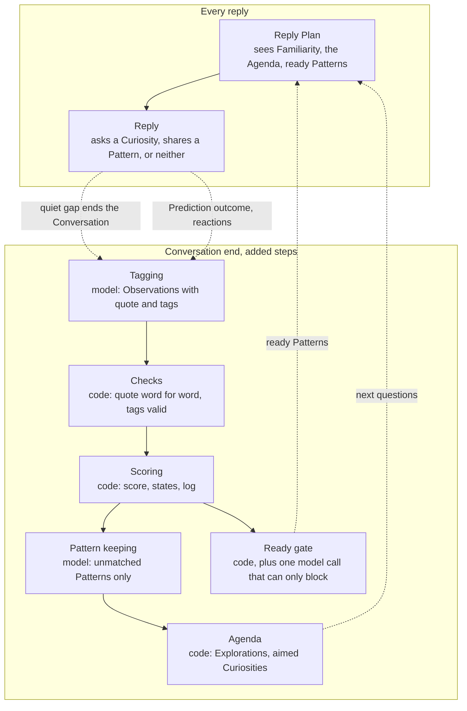

# How Zeph finds, tests and shares a Pattern

Read this before planning or changing Patterns, Observations, Curiosities, the Agenda or Thought Experiments. Terms in **bold** are defined in `CONTEXT.md`. The reply path itself is in `docs/message-pipeline/README.md`.

**Status:** target design, agreed 24 Nov 2026. **Not built yet.** Until it is, Patterns work as ADR-0020 says. Every decision behind it, with starting numbers and the first fifteen Pattern Types, is in `.scratch/pattern-pipeline/grill-decisions.md`.

**Built so far:** the Pattern Catalog loads from `src/companion/seed/pattern_catalog/` when the backend starts, and Admins read it on the Dashboard's Pattern Catalog page (ADR-0025). Nothing reads it in the reply path yet.

## What it is for

Zeph helps a User see their own patterns. It turns everyday conversations and Thought Experiments into evidence-backed Patterns about how they act in different situations, and they test them in their own life.

Two rules run through all of it:

- **The model reads and words; code decides.** A model tags what a User said, words a question and words a shared Pattern. Code checks, scores, moves states and decides what may be shared. Prompts hold no numbers.
- **Zeph is proactive, the gate is strict.** Zeph digs, asks and has opinions freely. The gate limits only what it claims about who a User is.

## The flow

Tagging runs after the Life Thread step, since an **Observation** needs its Thread.

## Each step

| Step | Who | What it does |
|---|---|---|
| Tagging | Model | Reads the Conversation, the Threads it touched and the whole **Pattern Catalog**. Writes **Observations**: Pattern Type and sign, for or against, the exact quote, who it's about, situation tags, kind of evidence, a context line. Names two Pattern Types when it can't tell (unclear). |
| Checks | Code | Drops any Observation whose Pattern Type or sign isn't in the catalog, whose quote isn't word for word in the User's own texts, or whose tags aren't from the fixed lists. Drops are counted in the Model Call Log. |
| Scoring | Code | Adds up weights with fading. Counts situations (one per Life Thread; different people within one add weight). Moves each Pattern between states and logs every move with its cause. |
| Pattern keeping | Model | Notes what recurs across Life Threads and fits no Pattern Type, as an unmatched Pattern. Never shared. |
| Agenda | Code | Keeps the User's active **Explorations**. For each, writes the next aimed **Curiosity**: settle an unclear story, look in a missing part of life, or run a counter-test. Picks the **Thought Experiment** for the look-alike pair with the most unclear evidence. |
| Ready gate | Code | Runs the checks below. One model call argues the other side and can only block. |
| Reply Plan | Model | Told the User's **Familiarity**, the Agenda with earlier tries, and any ready Pattern. Picks the moment. What code didn't offer, it can't use. |

## When a Pattern is ready

All of these, checked by code:

1. Seen in enough situations (Life Threads).
2. Across enough Conversations.
3. Resting on clear Observations, not unclear ones.
4. Score past the bar.
5. Tested against itself: a counter-test asked and answered, evidence against under a bar.
6. Observations where anyone would act the same carry no weight.
7. Every quote checked word for word.
8. The other-side model call found no better explanation.
9. Safe: no exclusion of its Pattern Type applies, no recent Safeguard Event, not a ruled-out topic unless the User raised it.
10. Not rejected by the User, and its Pattern Type is approved.

## Sharing

A ready Pattern is shared in chat at a moment the Reply Plan picks, or as a Check-in if none comes in time. Always as Zeph's view, in three parts: the Pattern in warm words, two or three of the User's own quotes from different parts of their life, and one **Prediction**. Zeph asks what would prove it wrong, and follows up on the Prediction later. Predictions that came true confirm the Pattern.

The **Read** is separate and free: a view of this situation, on every reply that has room for one.

## What Users and Admins see

| Who | Sees |
|---|---|
| User | Patterns Zeph has told them about (being tested, confirmed, "you disagreed", "didn't hold up"), each with its quotes and Prediction. Every kept quote under "Things you said that Zeph kept", with no Pattern named. Never a number. |
| Admin | Counts per User and their Familiarity. The Pattern Catalog, read-only. Thought Experiments, editable. A review list of what keeps turning up unmatched, as general descriptions with no User details. |

## Rollout

Three Features, each needing the one before, all off to start, switched per User or for everyone:

1. **Pattern noticing:** tagging and scoring run silently.
2. **Pattern exploring:** the Agenda, aimed Curiosities and Thought Experiments.
3. **Pattern sharing:** approved Pattern Types are shared with Predictions.

## Build order

1. Curiosity standing fix (per-Need field; a picked Curiosity is part of the plan). No catalog needed.
2. Catalog, tagging, Observations, the Tagging Eval, "Things you said that Zeph kept".
3. Scoring, states, the log, unmatched Patterns, moving existing Patterns across.
4. Agenda, Explorations, Thought Experiments, Familiarity, starter questions.
5. Ready gate, sharing, Predictions, the new Patterns tab.
6. Unmatched review page, the directness setting, remaining guides.

Related decisions: ADR-0024 (Patterns tested by code), ADR-0025 (Pattern Types in git), ADR-0026 (Curiosities have an aim), ADR-0027 (quotes outlive Message Retention), ADR-0017 (guesses are Curiosities), ADR-0021 (small one-job steps).
