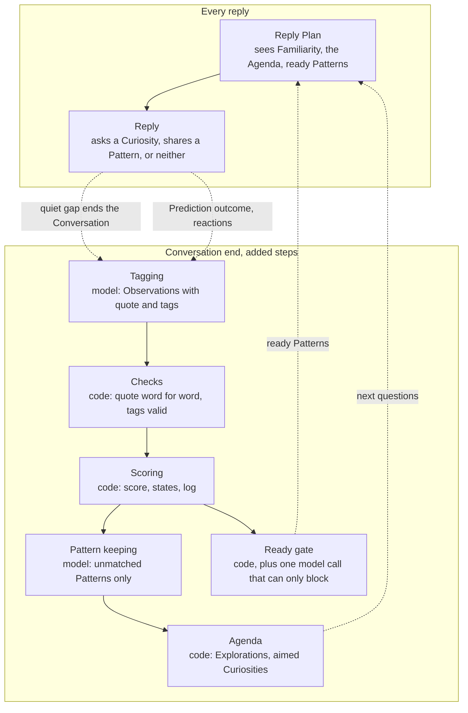

# How Zeph finds, tests and shares a Pattern

Read this before planning or changing Patterns, Observations, Curiosities, the Agenda or Thought Experiments. Terms in **bold** are defined in `CONTEXT.md`. The reply path itself is in `docs/message-pipeline/README.md`.

**Status:** target design, agreed 24 Nov 2026. **Not built yet**, except where a "Built" note says so. Every decision behind it, with starting numbers and the first fifteen Pattern Types, is in `.scratch/pattern-pipeline/grill-decisions.md`.

**Built so far:** the Pattern Catalog loads from `src/companion/seed/pattern_catalog/` when the backend starts, and Admins read it on the Dashboard's Pattern Catalog page (ADR-0025).

**Built (24 Nov 2026): Tagging and Checks.** `PatternTagger` in `core/observations.py` runs at Conversation end after Life Threads and before Pattern keeping, only while User Memory and the Feature **Pattern noticing** work (off for everyone to start). One model call (`pattern_tagging_prompt`, `pattern_tagging_model`, `pattern_tagging_thinking`, in the core services list) is given today, the Threads the Conversation touched (numbered), every current Pattern Type (signs for and against with their strength, look-alikes, what anyone would do), the tag lists and the Conversation, and answers `{"observations": [...]}`; an unreadable answer is asked once more. Code (`plan_observations`, pure) keeps an Observation only when: it names one Pattern Type in the catalog, or two different ones (unclear, the first one's sign); its sign is in the first Pattern Type's signs for when it is "for", or signs against when "against"; its quote is word for word in one of the User's own texts of that Conversation (text messages and photo captions; never the Companion's texts or a photo's description; runs of spaces and curly quotes evened out, nothing else, and never across two texts); relationship, power, setting and stance come from their lists or are empty; the kind of evidence comes from its list; it has a context line and who it is about; and it isn't an exact repeat. A Thread number it wasn't shown leaves it without a Thread. It is situational when its tags fit one of its Pattern Type's `anyone_would_when` tag matches (a new optional catalog field; for each tag a match names, the Observation's value is one listed; only CONF.AVOID.BELONG has them, from 0.2.0: strangers, or someone above them). Kept ones go in `observations` (migration 0082) with the Pattern Type versions, day the quote was sent (User's time zone), Thread, who, tags, kind, unclear and situational; they keep the quote with no link to its message, so Message Retention never deletes them; they go with their Thread, Delete My Data and Account Deletion. The Model Call Log's tagging call keeps `tagging_shape` (tagged, dropped), for every User, shown on the trace page as "Observations tagged" and "Dropped by code". Nothing reads Observations yet: no reply, Pattern or Dashboard page. Limits: the exclusion flag, linking to Patterns and scoring (issue 12), and the kept-quotes list (13) were still to come then (the Tagging Eval is built, below); the Admin Pattern Catalog page doesn't show `anyone_would_when` yet; ACH.WORTH.PERF's and CTRL.UNCERT.PLAN's "anyone would" (high stakes, a real crisis) can't be put as tags, so none of theirs is ever situational.

**Built (24 Nov 2026): Things you said that Zeph kept.** The Memories page has an eighth tab, "Things you said" (`?tab=quotes`, `KeptQuotesList`), listing every Observation's quote, Zeph's note (its context line, shown apart) and day, newest day first, with no Pattern Type or Pattern named; `GET /api/kept-quotes` and `DELETE /api/kept-quotes/{id}` (`UserMemoryService.list_kept_quotes`, `delete_kept_quote`) work whether User Memory is on or off. Deleting one scores the User's Patterns again at once (`observations_deleted`). Scoring and deleting a quote each lock the User's row (`Transaction.lock_user`) with their reads and writes, so a Conversation end already scoring finishes first and a deleted quote is never counted in a state saved after it. Telling Users first: `users.pattern_noticing_told_at` (migration 0085); `/api/me` says `show_pattern_noticing_notice` while Pattern noticing works for them and they haven't been told, and Home and Memories show the notice (`PatternNoticingNotice`, Shared Copy `shared.pattern_noticing.*`) until they press "Got it" (`POST /api/me/pattern-noticing-told`); the tagging step keeps nothing until then. One rule for every User, new or existing. Account's retention line adds `account.delete_data.kept_quotes`. Admins see a "Kept quotes" count on the Users panel when above 0 (`kept_quote_count`), never the quotes. Limits: tagging's insert isn't under the lock (safe while nothing tags a Conversation twice); the "Kept quotes" Admin row isn't drawn in `AdminUsers.html`.

**Built (24 Nov 2026): Scoring, states and the log.** `PatternScorer` in `core/pattern_scoring.py` runs right after tagging at Conversation end, while Pattern noticing works, and again at once when deleting a Life Thread removes Observations. A Pattern of a Pattern Type lives in the same `patterns` table as the old ones (migration 0083: `pattern_type_id`, one per User and Pattern Type; the written `pattern` is empty for them); every old-style reader (Recall, Pattern keeping, the Patterns tab, the Portrait, deleting Patterns with no evidence) reads only rows with no Pattern Type, so nothing reaches a reply. Its Observations are the User's Observations naming its Pattern Type, first or second; any Observation makes a noticed Pattern. Pure rules (`plan_pattern_moves` and the functions it calls): an Observation is worth its sign's points (the sign in the current catalog version of its first Pattern Type, also when it counts toward the second) times its kind of evidence, cut to the unclear percent toward each of its two Pattern Types, nothing when situational, negative when against, and halved every half-life since its day. A situation is its Life Thread, or with none the same person (`about`, trimmed, any case) and setting; in it, for and against apart, only the strongest Observation per person counts, up to the cap of people. A situation counts toward "situations" only when its part for is above 0. The score is worked out when read and never stored; the state is. Under the floor → closed; at the suspected situations and score → suspected; else noticed. States follow the evidence, so moves go back too (suspected → noticed when evidence is deleted or fades, closed → noticed when the score comes back over the floor); a Pattern in ready, shared, confirmed or contested is never moved or deleted by scoring. A noticed, suspected or closed Pattern left with no Observations is deleted. Every move goes in the append-only `pattern_moves` log (User, Pattern, Pattern Type, from, to, cause `conversation_tagged` with the Conversation or `observations_deleted`, score and situations at the move, when), with no words of the User's; it stays when its Pattern is deleted and goes only with Delete My Data and Account Deletion. Numbers are whole-number Platform Settings with hints, in a Patterns section of Platform settings and overridable in Eval Variants: sign points 30 / 70 / 140 (decision 29's 1.0 is 100 points), kind of evidence 100 / 70 / 40 / 30 %, unclear 25 %, half-life 75 days, 3 people per situation, suspected at 2 situations and 100 points, closed under −150 points. Admins see how many Patterns each User has in each state on the Users page (a row per state with any, beside "Confirmed Patterns"; old-style Patterns are counted by their state too). Limits: ready, shared, confirmed and contested (issues 07 to 09) are still to come (unmatched Patterns and moving old ones across are built, below); the log has no Admin page yet; when a Pattern is deleted for having no Observations, no move records it; a sign missing from the current catalog version counts nothing.

**Built (24 Nov 2026): the Tagging Eval.** A ninth Eval kind, `tagging` (`core/evals/tagging_eval.py`), with no Judge. A case is a made-up ended Conversation, the Life Threads it touched and the Observations expected (Pattern Type, for or against, unclear, situational). The made-up User has Pattern noticing on and has been told; the Threads and Conversation are saved and `PatternTagger.tag_from` runs alone on them, with the Eval database's Platform Settings (a Variant can override `pattern_tagging_prompt`, `_model`, `_thinking`) and the Pattern Catalog, which the Eval database now loads from its files for every case. `plan_observations` now returns each dropped entry with its `DropReason`, and `tag_from` returns what it planned. A case passes only when every expected Observation is matched by a kept one (same direction, unclear and situational; the Pattern Type is its first or, when unclear, either of its two) and every kept one matches one expected; several kept quotes may match one. The Case Result's `tagging` part (expected with matched, kept, dropped with why) is shown on the Dashboard (`TaggingObservations`; reference `web/design/reference/AdminEvalTaggingCase.html`). 44 seed cases in `seed/evals/cases/tagging.yaml`, drafted for the owner to correct. `make eval` now prints the estimate before queueing. What the Pattern Evals can and can't show, and what must be done later: `docs/pattern-evals/README.md`.

**Built (24 Nov 2026): Explorations and the Agenda.** Behind the Feature **Pattern exploring** (off for everyone to start; works only while Pattern noticing works, shown as "Off: Pattern noticing is off for this user"). `AgendaKeeper` in `core/agenda.py` runs at Conversation end after Curiosities, while Pattern exploring and Curiosities work, with the User locked like scoring. No model call. Pure rules (`plan_agenda` and the functions it calls): every aimed Curiosity asked is judged (`try_outcome`): brushed off or asked to drop → brushed off; the unclear story it aimed at now clear → useful; engaged and an Observation of its Pattern Type came from that Conversation → useful; else vague. Each suspected Pattern gets an Exploration (`explorations`, migration 0088, goes with its Pattern). One rests after `exploration_rest_after_tries` (4) tries with nothing in a row (counted since it last woke) or at once when asked to drop, closing its waiting aimed Curiosity; a resting one wakes when an Observation of its Pattern is tagged after it rested. The rest, while their Pattern is suspected, are ranked by score, then oldest, and the top `agenda_size` (3) are active. Open needs (`open_needs`), from the Pattern's Observations: unclear stories, newest first; a part of life (home, work, with friends) with no Observation while another has one; a counter-test, open until an Observation against comes or a counter-test try was useful. For each active Exploration with no waiting aimed Curiosity, not tried in the Conversation that just ended (so never two Conversations in a row), code writes one for the top need (`aimed_question`): a plain instruction from the story's day and context line, the Pattern Type's "if" and the part of life, never the Pattern's name or the User's quote; least pushy way first (story follow-up → "would it have gone differently with…" → "this week, notice when…"), a different way after a try with nothing, not before the last try's day + `exploration_wait_days` (3) after a try with nothing. A waiting one no longer aimed at the top need is closed and replaced. Each try is kept in `exploration_tries` (need, way, Observation or part of life aimed at, outcome); when and where it was asked are its Curiosity's (`curiosities.exploration_id`, `source_observation_id`; deleting the Exploration or the Observation deletes the Curiosity and its try). `AgendaReader` gives the Reply Plan the active Explorations in rank order on every reply (none while struggling): each Pattern Type's name and if/then, marked never to say, its open needs and earlier tries (day, way, question, outcome), and a line to aim a question-asking Move at an open need; the Reply gets the open needs in plain words when its lead or supporting Move asks a question. Aimed Curiosities come first among the due ones, also for Curiosity Check-ins, and none is offered while Pattern exploring is off; the Curiosity keeping step never sees, edits or closes waiting aimed ones, and they don't count toward the waiting limit. The tagging step is shown the unclear stories an aimed Curiosity asked about in the Conversation and may answer `settled`; code (`plan_settled`) keeps one only for one of its two Pattern Types and a sign of it in the same direction, and makes the Observation clear. Migration 0088 reloads `pattern_tagging_prompt` and `reply_plan_prompt` from the seed. The three numbers are in the Patterns section of Platform settings with hints and overridable in Eval Variants. Turning Pattern exploring off makes and deletes nothing. Delete My Data and Account Deletion remove Explorations and tries. Limits: Thought Experiments (issue 05) are not a way yet; an Observation from earlier in the same Conversation can make a try useful; a Check-in that asks an aimed Curiosity with no reply counts as a vague try; deleting a story deletes the tries aimed at it, so their count and a met counter-test can start over; Admins see no Explorations yet.

**Built (24 Nov 2026): the full first catalog.** Fifteen Pattern Types, three per area (decision 30), approved by the owner (Zaf) on 24 Nov 2026, in `src/companion/seed/pattern_catalog/`. The twelve new ones are at 0.1.0; CONF.AVOID.BELONG (0.3.0), CTRL.UNCERT.PLAN (0.2.0) and ACH.WORTH.PERF (0.2.0) gained look-alikes. Every look-alike pair is named both ways, and a test checks it, and checks no clinical terms are used outside `frameworks`. `anyone_would_when` is now also set for CONF.DEFEND.SELF (a hostile stance), CONF.WITHDRAW.HURT, APPR.HIDE.BURDEN and REL.DISTANCE.INDEP (strangers and acquaintances), and APPR.GIVE.NEEDED and APPR.CONFIRM.CHOICE (someone above them at work). The Tagging Eval seed has 24 more cases, one for and one against each new Pattern Type (68 in all). How to change or add a Pattern Type, and what each change does: `docs/pattern-catalog/README.md`.

**Built (24 Nov 2026): unmatched Patterns and moving the old ones across.** `PatternState` gains `unmatched`: the state of a Pattern with no Pattern Type that the keeping step wrote. It is apart from the seven states code moves a Pattern of a Pattern Type between. Migration 0091 keeps every Pattern kept before the catalog with all its evidence: suspected ones become unmatched (hidden, as before), confirmed stay confirmed and shown, closed stay closed; it also reloads `pattern_keeping_prompt` from the seed. **Pattern keeping** (`PatternKeeper` in `core/patterns.py`) now only notes unmatched Patterns: it is shown the Pattern Types (name, if / then / function, definition, no IDs) so it leaves those to tagging (only for a User tagging runs for: Pattern noticing works and they pressed "Got it"; otherwise it is shown none, so what recurs is still kept somewhere), starts an unmatched Pattern only with evidence from two or more Threads, and adds evidence only to unmatched ones. It no longer reads how the User took a view, and never confirms or closes; whatever state or reaction the model writes is ignored, and it never sees a Pattern of a Pattern Type. It runs whether Pattern noticing works or not. **In replies** an unmatched Pattern still comes to mind (through its Threads or by meaning) and the Reply Plan may build its Read on it, marked "never offer it or say it as a pattern"; code drops `offer_pattern` unless the Pattern is confirmed. **Matching** (`PatternMatcher` in `core/pattern_matching.py`) runs only from the Admin command `make match-patterns` (`python -m companion.pattern_matching_terminal`, `TYPES=ID,ID` to match against only some Pattern Types, e.g. ones just added). For each Pattern with no Pattern Type and no match yet (unmatched, confirmed or closed), one model call (`pattern_matching_prompt`, `_model`, `_thinking`, in the core services list; step and trace kind `pattern_matching` in the Model Call Log) is given the Pattern Types and the Pattern with its evidence and answers `{"pattern_type": "<ID>" | null}`; an unreadable answer is asked once more; code keeps the answer only when the ID is one it was given. A match is a link (`patterns.matched_pattern_type_id`), saved once its evidence was tagged again, so a run that fails part-way is done again by the next: the Pattern keeps its words, state and evidence, and once linked is not asked about again. Then, for matched Patterns that aren't closed, each Conversation started on a day of their evidence whose messages Message Retention still keeps is tagged again (`PatternTagger.tag_again`) against only the Pattern Types matched that day, with the evidence's Threads, under the same checks as any tagging (word-for-word quote, sign, tags); an Observation already kept from that Conversation (same Pattern Type, sign and quote) isn't kept twice. New Observations score the User's Patterns again (cause `evidence_tagged_again` in the log), so a Pattern of that Pattern Type is noticed the usual way. Only Users for whom Pattern noticing works and who pressed "Got it" are looked at; the rest are reported as skipped and left for a later run, and one User failing doesn't stop the others. The command prints IDs and counts (Patterns looked at and matched, Conversations tagged again, Observations kept, evidence days with no messages left), never a User's words, and exits 1 when a User's run failed. Admins see an "Unmatched Patterns" count per User. Limits: evidence whose messages are already deleted can't become Observations (they need the User's exact words); a Pattern keeps its first match, so it is not checked against Pattern Types added later; a matched Pattern and the Pattern of that Pattern Type are two rows, joined only by the link, so the ready gate (issue 07) must check the link before sharing what a User already agreed with; a confirmed Pattern from before the catalog can still be offered with the Read, and how the User takes it is no longer recorded; the general description and the Admin review page are issue 17.

## What it is for

Zeph helps a User see their own patterns. It turns everyday conversations and Thought Experiments into evidence-backed Patterns about how they act in different situations, and they test them in their own life.

Two rules run through all of it:

- **The model reads and words; code decides.** A model tags what a User said, words a question and words a shared Pattern. Code checks, scores, moves states and decides what may be shared. Prompts hold no numbers.
- **Zeph is proactive, the gate is strict.** Zeph digs, asks and has opinions freely. The gate limits only what it claims about who a User is.

## The flow

Tagging runs after the Life Thread step, since an **Observation** needs its Thread.

## Each step

| Step | Who | What it does |
|---|---|---|
| Tagging | Model | Reads the Conversation, the Threads it touched and the whole **Pattern Catalog**. Writes **Observations**: Pattern Type and sign, for or against, the exact quote, who it's about, situation tags, kind of evidence, a context line. Names two Pattern Types when it can't tell (unclear). |
| Checks | Code | Drops any Observation whose Pattern Type or sign isn't in the catalog, whose quote isn't word for word in the User's own texts, or whose tags aren't from the fixed lists. Drops are counted in the Model Call Log. |
| Scoring | Code | Adds up weights with fading. Counts situations (one per Life Thread; different people within one add weight). Moves each Pattern between states and logs every move with its cause. |
| Pattern keeping | Model | Notes what recurs across Life Threads and fits no Pattern Type, as an unmatched Pattern. Never shared. |
| Agenda | Code | Keeps the User's active **Explorations**. For each, writes the next aimed **Curiosity**: settle an unclear story, look in a missing part of life, or run a counter-test. Picks the **Thought Experiment** for the look-alike pair with the most unclear evidence. |
| Ready gate | Code | Runs the checks below. One model call argues the other side and can only block. |
| Reply Plan | Model | Told the User's **Familiarity**, the Agenda with earlier tries, and any ready Pattern. Picks the moment. What code didn't offer, it can't use. |

## When a Pattern is ready

All of these, checked by code:

1. Seen in enough situations (Life Threads).
2. Across enough Conversations.
3. Resting on clear Observations, not unclear ones.
4. Score past the bar.
5. Tested against itself: a counter-test asked and answered, evidence against under a bar.
6. Observations where anyone would act the same carry no weight.
7. Every quote checked word for word.
8. The other-side model call found no better explanation.
9. Safe: no exclusion of its Pattern Type applies, no recent Safeguard Event, not a ruled-out topic unless the User raised it.
10. Not rejected by the User, and its Pattern Type is approved.

## Sharing

A ready Pattern is shared in chat at a moment the Reply Plan picks, or as a Check-in if none comes in time. Always as Zeph's view, in three parts: the Pattern in warm words, two or three of the User's own quotes from different parts of their life, and one **Prediction**. Zeph asks what would prove it wrong, and follows up on the Prediction later. Predictions that came true confirm the Pattern.

The **Read** is separate and free: a view of this situation, on every reply that has room for one.

## What Users and Admins see

| Who | Sees |
|---|---|
| User | Patterns Zeph has told them about (being tested, confirmed, "you disagreed", "didn't hold up"), each with its quotes and Prediction. Every kept quote under "Things you said that Zeph kept", with no Pattern named. Never a number. |
| Admin | Counts per User and their Familiarity. The Pattern Catalog, read-only. Thought Experiments, editable. A review list of what keeps turning up unmatched, as general descriptions with no User details. |

## Rollout

Three Features, each needing the one before, all off to start, switched per User or for everyone:

1. **Pattern noticing:** tagging and scoring run silently.
2. **Pattern exploring:** the Agenda, aimed Curiosities and Thought Experiments.
3. **Pattern sharing:** approved Pattern Types are shared with Predictions.

## Build order

1. Curiosity standing fix (per-Need field; a picked Curiosity is part of the plan). No catalog needed. *Built (24 Nov 2026), with "test the water", pace and backing off: see "6. Reply Plan", "7. Reply" and "d. Curiosities" in `docs/message-pipeline/README.md`.*
2. Catalog, tagging, Observations, the Tagging Eval, "Things you said that Zeph kept".
3. Scoring, states, the log, unmatched Patterns, moving existing Patterns across.
4. Agenda, Explorations, Thought Experiments, Familiarity, starter questions. *Agenda and Explorations built (24 Nov 2026), above.*
5. Ready gate, sharing, Predictions, the new Patterns tab.
6. Unmatched review page, the directness setting, remaining guides. *Directness setting built (24 Nov 2026): see "6. Reply Plan" in `docs/message-pipeline/README.md`.*

Related decisions: ADR-0024 (Patterns tested by code), ADR-0025 (Pattern Types in git), ADR-0026 (Curiosities have an aim), ADR-0027 (quotes outlive Message Retention), ADR-0017 (guesses are Curiosities), ADR-0021 (small one-job steps).
