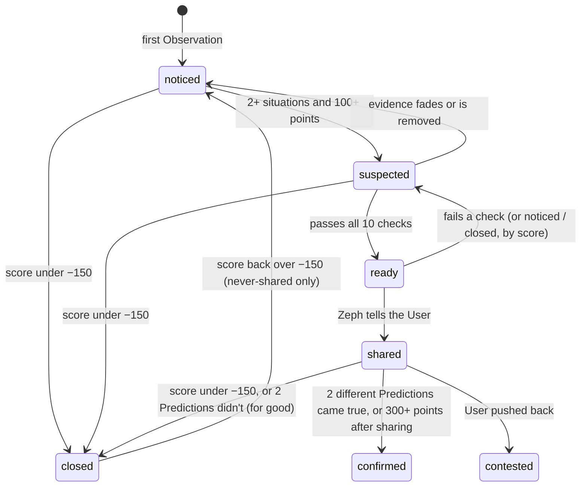

# Lifecycle of Observations and Patterns

How an Observation is made, scored and removed, and how a Pattern moves between states. For the full design, see `README.md` in this folder. Every number below is a Platform Setting (Patterns section) and can be changed.

## Observations

An **Observation** is one piece of evidence for or against a Pattern, taken from something the User said.

### What it holds

- The User's exact quote (a short span, never the whole message).
- A context line on what was going on, in Zeph's words.
- The day, its Life Thread (if any), and who it was about.
- Tags from fixed lists:

| Tag | Values |
|---|---|
| Pattern Type and sign | from the Pattern Catalog |
| Direction | for or against |
| Relationship | partner, family, friend, acquaintance, colleague, stranger |
| Power | above, equal, below |
| Setting | home, work, social, online |
| Other person's stance | supportive, neutral, hostile |
| Audience | one-to-one, group, in front of others |
| Stakes | low, high |
| State going in | worn out, under pressure, low, steady |
| Kind of evidence | real story, reported habit, "what if" answer, own opinion |

If the model can't tell two look-alike Pattern Types apart, it names both and the Observation is **unclear**.

Relationship, power, setting, stance, audience, stakes and state going in are the Observation's **Conditions**. Each is filled only when the User's story says it. Time of day and the kind of event are not tagged (ADR 0031).

### Lifecycle

1. **Made.** At Conversation end, the tagging model reads the Conversation and writes Observations. This only happens while User Memory and Pattern noticing are on, and after the User has pressed "Got it" on the notice.
2. **Checked.** Code drops any Observation whose quote isn't word for word in the User's texts, or whose Pattern Type, sign or tags aren't valid. It also drops a quote the User deleted before, and any Observation for a Pattern Type they marked "never again" (see below).
3. **Scored.** Its points count toward its Pattern (see Scoring). Its weight halves every 75 days.
4. **Kept.** It has no end date. Message Retention deletes the raw message after 30 days, but the Observation keeps its own copy of the quote (ADR 0027). The User sees every kept quote under "Things you said that Zeph kept". Admins see counts only.
5. **Removed** only when:
   - the User deletes that quote,
   - the User deletes its Life Thread,
   - the User deletes a Pattern they were told about (its Observations go with it),
   - the User uses Delete My Data or deletes their account.

   Every removal scores the User's Patterns again straight away.

   When a User deletes a quote, a Pattern or a Life Thread, a record of each deleted quote is kept (the Conversation, a hash of the message and where the quote sat in it, never the words), so tagging that day again can never keep it again, in the same words or a longer or shorter cut of them.

   **"Never again".** When the deleted Pattern was one they disagreed with, or one that didn't hold up, its Pattern Type is marked for that User: no Observation is kept for it and no Pattern starts for it again. Delete My Data removes the mark.

## Scoring

Code scores each Pattern at every Conversation end and whenever Observations are removed. The score is worked out fresh each time and never stored. Only the state is stored.

### Points per Observation

```
points = sign points × kind of evidence % × unclear % × fading
```

| Part | Value |
|---|---|
| Sign points | weak 30, moderate 70, strong 140 |
| Kind of evidence | real story 100%, reported habit 70%, "what if" answer 40%, own opinion 30% |
| Unclear | 25% toward each of its two Pattern Types |
| Fading | halved every 75 days since its day |
| Against | the points count as negative |
| Situational | 0 when anyone would act the same there |
| Only narrows the Pattern | left out: "not with my partner" marks where the Pattern stops (see Narrowing) |

### Situations

Evidence is grouped by **situation**: its Life Thread, or with none, the same person and setting.

Inside one situation, for and against are counted apart. For each person, only their strongest Observation counts, up to 3 people. Five stories about the same boss count once; stories about three different people count three times.

A situation only counts toward the Pattern's "situations" when its points for are above 0, and something other than a "what if" answer is what counts for it.

## Pattern states

| State | Means | Seen by User |
|---|---|---|
| **noticed** | Has at least one Observation, not enough evidence yet | No |
| **suspected** | 2+ situations and 100+ points | No |
| **ready** | Passed all 10 ready-gate checks, waiting to be shared | No |
| **shared** | Zeph told the User and gave a Prediction to watch for | Yes |
| **confirmed** | Two different Predictions came true, or strong new evidence came after sharing | Yes |
| **contested** | The User pushed back after it was shared | Yes |
| **closed** | Score under −150, or (once shared) 2 Predictions didn't come true | Only if it was shared |
| **unmatched** | Recurs but fits no Pattern Type. Never shared, never moved by code | No |

### How states change



**1. Scoring (noticed, suspected, closed).** States follow the score and can go back. A noticed, suspected or closed Pattern left with no Observations is deleted. Scoring never moves a Pattern that is ready, shared, confirmed or contested.

**2. Ready gate (suspected → ready).** Code checks, in order:

1. Seen in enough situations.
2. Across enough Conversations.
3. A counter-test was asked and answered, and the evidence against stays low.
4. Score past the bar.
5. Its clear Observations alone are enough.
6. Still enough without the "anyone would act the same" Observations.
7. Safe: no exclusion applies, no Safeguard Event in the last 14 days, not a ruled-out topic the User didn't raise.
8. Its Pattern Type is approved and the User hasn't rejected it.
9. Every quote checked word for word again.
10. A model call finds no better explanation. It can only block.

A ready Pattern is checked again at every Conversation end. If it fails, it goes back to where its score puts it.

**Narrowing.** Any Condition can narrow a Pattern: relationship, power, stance, setting, audience, stakes or the state going in. Each is looked at alone. One narrows the Pattern when at least 2 clear stories for it say that Condition (`narrowing_stories_needed`) and all the clear evidence against that says it is under other values ("shows in a group, not one-to-one"). At most 2 narrow one Pattern (`narrowings_per_pattern`): those with the most stories, ties going audience, stakes, relationship, power, stance, setting, state. Evidence against that a kept narrowing explains doesn't count against the Pattern, in scoring as well as in the gate (one function, `without_narrowing`). Evidence against that no kept narrowing explains counts in full. Evidence against that doesn't say the Condition (a summing-up line like "it's only with mum that I cave") is left out of the narrowing check: it doesn't narrow the Pattern and doesn't stop it being narrowed, and it still counts against in full. Conditions never add points or situations.

**3. Sharing (ready → shared).** The Reply Plan picks a moment, or a Check-in shares it. Zeph gives the Pattern in warm words with where it shows and where it doesn't, two or three of the User's quotes, and one **Prediction**. When the stories so far are one-sided on a Condition, Zeph also says one thing it hasn't seen ("I've only heard about this in meetings. I don't know if it's the same when it's just the two of you"), as something it doesn't know and never as a claim; never a state. If the User asks what patterns Zeph sees in them, a ready Pattern is shared then; with none ready or told, Zeph says it is still getting to know them. The wording it was told in is kept on the Pattern.

**4. After sharing (shared → confirmed, contested or closed).** Each Pattern Type has three Predictions, each testing a different side of it. Sharing gives the first; later ones are those the Pattern hasn't had. Zeph asks how a Prediction went when the User next talks about a person or part of their life the Pattern showed with (from the day after it was given), or else 7 to 21 days later. The User's answer counts as evidence: "came true" is a strong sign for, "didn't" a strong sign against, and "hasn't come up" adds nothing and starts a new wait. A story that answers a Prediction counts once: that Conversation's Observations for the same Pattern Type count nothing. Then, in this order:

1. Score under −150 → **closed**, for good.
2. 2 different Predictions didn't come true, and more didn't than did → **closed**, for good.
3. 2 different Predictions came true, and more did than didn't → **confirmed**. (The same wording passed or failed twice counts once.)
4. Observations from days after sharing reach 300 points → **confirmed**.

A Prediction nobody answers within 21 days counts nothing and Zeph offers a new one. After 2 in a row go unanswered, Zeph offers no more for that Pattern until the User brings the Pattern up.

If the User pushes back on a shared Pattern, it becomes **contested** and is never offered again.

Confirmed, contested and shared-then-closed Patterns never move again.

**5. Used in replies.** A Pattern being tested or confirmed is shown to every Reply Plan (not while the User is struggling), with where it last showed up and where they last acted against it. Zeph may link today's story to it: "the thing we're testing" for one being tested, plainly for a confirmed one.

### The log

Every move is written to `pattern_moves`: from, to, the cause, the score and situations at the time, and the check that blocked it, if any. It holds no words of the User's, and is removed only by Delete My Data or Account Deletion.

## What Zeph asks about a suspected Pattern

Each suspected Pattern on the Agenda has an **Exploration**. Code works out what it still needs, in this order, and writes one aimed question for the first:

1. **An unclear story**, newest first.
2. **A counter-test**, until an Observation against comes or a counter-test question came back useful.
3. **A missing Condition.** Code counts, per Condition and value, the clear stories for and against (the coverage table: not unclear, not situational, not excluded; never stored). A value is worth asking about only when:
   - at least 2 clear stories for the Pattern say that Condition and all share one value ("Stories that make a Condition one-sided"),
   - another value of it has no clear story, for or against,
   - it is the Condition with the most such stories. Ties go in this order: audience, stakes, relationship, power, stance, setting, state going in.

   A useful answer closes that value for good. For the state going in it closes every value, since the question is the same open one.

How it asks is its **Approach**. The order, the wait after a try with nothing and the tries before the Exploration rests follow how direct the User set Zeph to be (issue 40):

| | Gentle | Balanced | Direct |
|---|---|---|---|
| Order of Approaches | story follow-up → Thought Experiment → "this week, notice…" | story follow-up → "would it have gone differently if…" → Thought Experiment → "notice" | "would it have gone differently if…" → story follow-up → Thought Experiment → "notice" |
| Wait after a try with nothing | 5 days | 3 days | 2 days |
| Rests after tries with nothing in a row | 3 | 4 | 5 |
| Fewest replies between two Curiosities | 4 | 3 | 2 |

A Thought Experiment is used for unclear stories only. A gentle User is never asked "would it have gone differently if…". The numbers are Admin-set. Whatever the setting: the spacing doubles after brush-offs, "drop it" rests the Exploration at once, nothing is asked while they are struggling, and never two Conversations in a row. A question already waiting when the User changes the setting is asked as written; the next one follows the new setting.

For the state going in, Zeph only asks openly how they were doing. It never names a state and never asks "would it have gone differently if" about one.

A Pattern that becomes ready leaves the Agenda, so a missing Condition is asked about only while something else still holds the Pattern back from ready.

## Where it lives in code

| What | File |
|---|---|
| Tagging and checks | `src/companion/core/observations.py` |
| Scoring and states | `src/companion/core/pattern_scoring.py` |
| Explorations, needs and Approaches | `src/companion/core/agenda.py` |
| The coverage table | `src/companion/core/condition_coverage.py` |
| Ready gate | `src/companion/core/ready_gate.py` |
| Sharing and reactions | `src/companion/core/pattern_sharing.py` |
| Predictions and confirming | `src/companion/core/predictions.py` |
| States | `PatternState` in `src/companion/core/models.py` |
